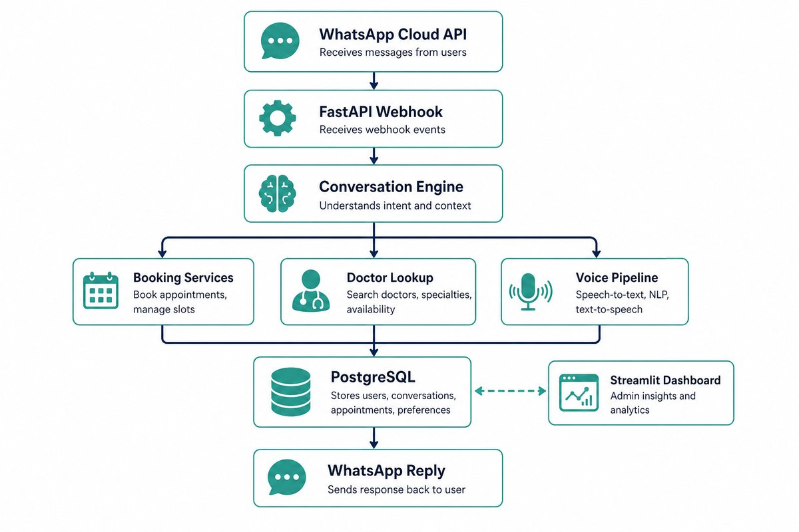

# Architecture

> **Audience:** developers  
> **Purpose:** system map — how messages move through the Hospital Chatbot

---

## 1. Overview

Hospital Chatbot is an AI-powered WhatsApp assistant for clinic appointment booking. Patients can book, reschedule, or cancel appointments, ask about doctors/specialties, send voice notes, and escalate to a receptionist when needed.

| Layer | Technology |
|:------|:-----------|
| API | FastAPI |
| Database | PostgreSQL |
| Messaging | WhatsApp Cloud API |
| AI / Voice | OpenAI + Whisper STT |
| Conversation | LangGraph-style engine |
| Admin UI | Streamlit dashboard |

---

## 2. High-level request flow

**Step-by-step**

1. WhatsApp delivers an inbound message (text, interactive reply, or voice) to the webhook.
2. The API layer authenticates/verifies the request and normalizes the payload.
3. The conversation layer loads the current session/conversation state for the patient phone.
4. The engine routes the turn by intent and state (booking, reschedule, cancel, inquiry, voice, handover, menu).
5. Domain services read/write appointments, slots, doctors, and related records in PostgreSQL.
6. The bot replies through WhatsApp (text, buttons, lists, and/or doctor cards).

| Stage | Component |
|:-----:|:----------|
| 1 | WhatsApp Cloud API (inbound message) |
| 2 | FastAPI webhook / API routes |
| 3 | Conversation engine (state + intent) |
| 4a | Booking / reschedule / cancel services |
| 4b | Doctor / department lookup |
| 4c | Voice STT + understanding + execution |
| 4d | Handover / fallback |
| 5 | PostgreSQL |
| 6 | WhatsApp outbound reply |

---

## 3. Main components

| Area | Path | Role |
|:-----|:-----|:-----|
| API / webhook | `app/api` | HTTP entry points, WhatsApp webhook, booking-related API routes |
| Conversation engine | `app/graph/conversation_engine.py` | Text/interactive turn handling, state transitions, menu/back navigation |
| Booking domain | `app/services/booking_service.py` | Hold/confirm slots, create/update/cancel appointments |
| Doctors / departments | `app/services/doctor_service.py` | Active doctors, departments, doctor cards |
| Voice pipeline | `app/services/voice_*.py` | Download media, STT, structure intent, execute next booking step |
| WhatsApp client | `app/services/whatsapp_client.py` | Send text, buttons, lists, media/cards |
| i18n / bot copy | `app/core/i18n_bot.py` | Arabic/English user-facing strings |
| Config | `app/core/config.py` | Environment-driven settings |
| Models | `app/models` | SQLAlchemy models |
| Dashboard | `dashboard/` | Streamlit admin UI |
| Migrations | `alembic/` | Schema versioning |

---

## 4. Conversation model

Conversations are tracked per clinic + patient phone and advance through explicit states.

### Booking states (happy path)

| # | State | What the patient does |
|:-:|:------|:----------------------|
| 1 | Main menu | Chooses an action |
| 2 | Path choice | Specialty **or** doctor name |
| 3 | Doctor | Selects a doctor |
| 4 | Date | Picks an available day |
| 5 | Time | Picks a slot |
| 6 | Details / confirm | Name (+ optional DOB) → confirm |
| 7 | Done | Receives appointment reference |

### Related flows

| Flow | Short path |
|:-----|:-----------|
| Reschedule | Pick appointment → change type → new date/slot → confirm |
| Cancel | Pick appointment → confirm cancellation |
| Inquiry | Doctors / specialties information |
| Handover | Escalate to receptionist with context |

> **Global commands:** type MENU to return to the main menu; type رجوع or Back to step one screen backward where implemented.

---

## 5. Voice path

| Step | Action |
|:----:|:-------|
| 1 | Patient sends a WhatsApp voice note |
| 2 | Media is downloaded from WhatsApp |
| 3 | Speech is transcribed (Whisper) |
| 4 | Understanding extracts intent/entities |
| 5 | Executor validates availability and advances booking when possible |
| 6 | Bot replies with the next step or confirmation |

> Voice is an **alternate input channel** into the same booking/conversation system — not a separate product.

---

## 6. External integrations

| System | Role |
|:-------|:-----|
| **WhatsApp Cloud API** | Inbound webhook events + outbound messages |
| **OpenAI** | Text/voice structuring + Whisper transcription |
| **PostgreSQL** | Clinic, doctor, slot, appointment, conversation data |

---

## 7. Design notes

- Business rules for slots and appointment changes live in **services**, not in the WhatsApp client.
- Interactive WhatsApp messages (buttons/lists) guide choices; free text still works for menu/navigation and some matching.
- **Alembic** owns schema changes; runtime expects migrations applied on deploy.
- Local and server environments may use different databases — verify production numbers on the server.
