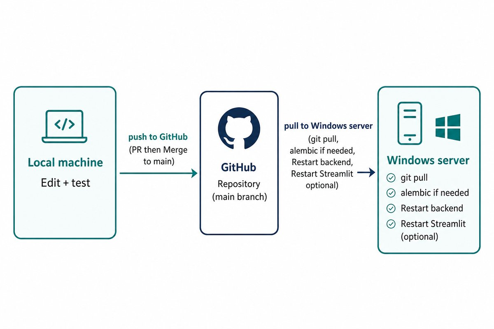

# Deploy Guide

> **Audience:** developers / ops  
> **Purpose:** ship code from local → GitHub → Windows production server

---

## Deploy path at a glance



| Step | Where | What you do |
|:----:|:------|:------------|
| 1 | Local machine | Edit, test, commit, push branch |
| 2 | GitHub | Open PR → `main` → Merge |
| 3 | Windows server | `git pull` |
| 4 | Windows server | Run Alembic if there are migrations |
| 5 | Windows server | Restart `HospitalChatbotBackend` |
| 6 | Windows server | Restart Streamlit **only if** dashboard code changed |

> **Reliable path:** merge to `main`, then update the server **manually**.  
> GitHub Actions auto-deploy may fail (SSH auth) — do not rely on it alone.

---

## 1) Local → GitHub

From the project root on your machine:

```powershell
cd E:\4S\hospital_chatbot
git checkout -b <branch-name>    # or switch to an existing branch
# after changes and testing:
git add <files>
git commit -m "short clear message"
git push -u origin <branch-name>
```

Then on GitHub:

| Step | Action |
|:----:|:-------|
| 1 | Open a Pull Request: branch → `main` |
| 2 | Review the diff |
| 3 | Merge |

After merge, production code is on `main`. Continue with the server update below.

---

## 2) Server update — backend bot

Connect with AnyDesk / RDP.

**Project path:** `C:\apps\hospital-chatbot`

```powershell
cd C:\apps\hospital-chatbot
git checkout main
git pull

# Only if requirements.txt changed:
.\venv\Scripts\pip.exe install -r requirements.txt

# Apply any new DB migrations:
.\venv\Scripts\python.exe -m alembic upgrade head

Restart-Service HospitalChatbotBackend
Get-Service HospitalChatbotBackend
Get-Content "C:\apps\hospital-chatbot\logs\stdout.log" -Tail 20 -Encoding UTF8
```

Expected service status: **Running**.

### Alembic note (existing databases)

| Situation | Command |
|:----------|:--------|
| First time only — DB already has full schema, Alembic never stamped | `alembic stamp head` |
| Every normal deploy after that | `alembic upgrade head` |

### Windows services

| Service | Purpose |
|:--------|:--------|
| `HospitalChatbotBackend` | Backend / WhatsApp bot |
| `NgrokTunnel` | Tunnel used for WhatsApp connectivity |

> There is **no** Windows service named `HospitalChatbotDashboard`. Do not use that name.

---

## 3) Server update — Streamlit dashboard

Dashboard is **not** a Windows service. Restart it manually after `git pull` when dashboard code changed.

**Official URL:** `http://196.219.86.38:8501/`

```powershell
cd C:\apps\hospital-chatbot
.\venv\Scripts\streamlit.exe run dashboard/streamlit_app.py --server.address 0.0.0.0 --server.port 8501
```

- Stop any old process on port `8501` first if needed.
- Keep the PowerShell window open while the dashboard should stay online.
- Open the URL and refresh the browser.

---

## 4) Local vs server

| Environment | URL | Notes |
|:------------|:----|:------|
| Local dashboard | `http://localhost:8501` | Usually a different DB → different numbers |
| Server dashboard | `http://196.219.86.38:8501/` | Official production view |
| Local API | `http://127.0.0.1:8000` | Dev only |

After a production deploy:

- You may stop local `uvicorn` / Streamlit / `cloudflared` with `Ctrl+C`.
- Do **not** stop Streamlit on the server if you want the public dashboard link to keep working.

---

## 5) Local webhook tunnel (optional)

For local WhatsApp webhook testing only:

```powershell
cd E:\4S\hospital_chatbot
.\cloudflared tunnel --url http://127.0.0.1:8000
```

This is for development. Production uses the server setup / tunnel service.

---

## Quick deploy checklist

- [ ] Changes committed and pushed
- [ ] PR merged into `main`
- [ ] Server: `git checkout main` + `git pull`
- [ ] `pip install` only if requirements changed
- [ ] `alembic upgrade head` if migrations exist
- [ ] `Restart-Service HospitalChatbotBackend`
- [ ] Service shows Running; logs look healthy
- [ ] Restart Streamlit only if dashboard files changed
- [ ] Spot-check WhatsApp bot (and dashboard if needed)
