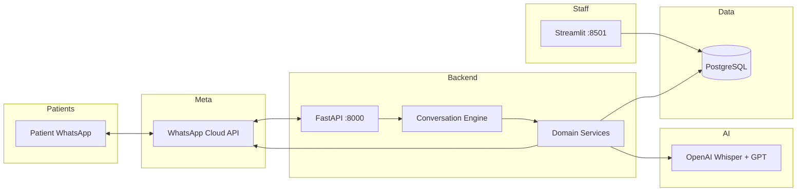
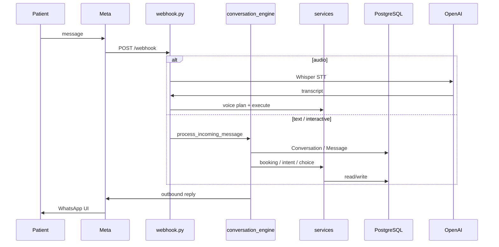
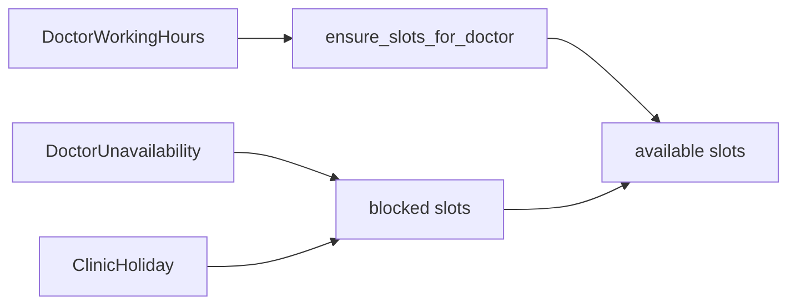
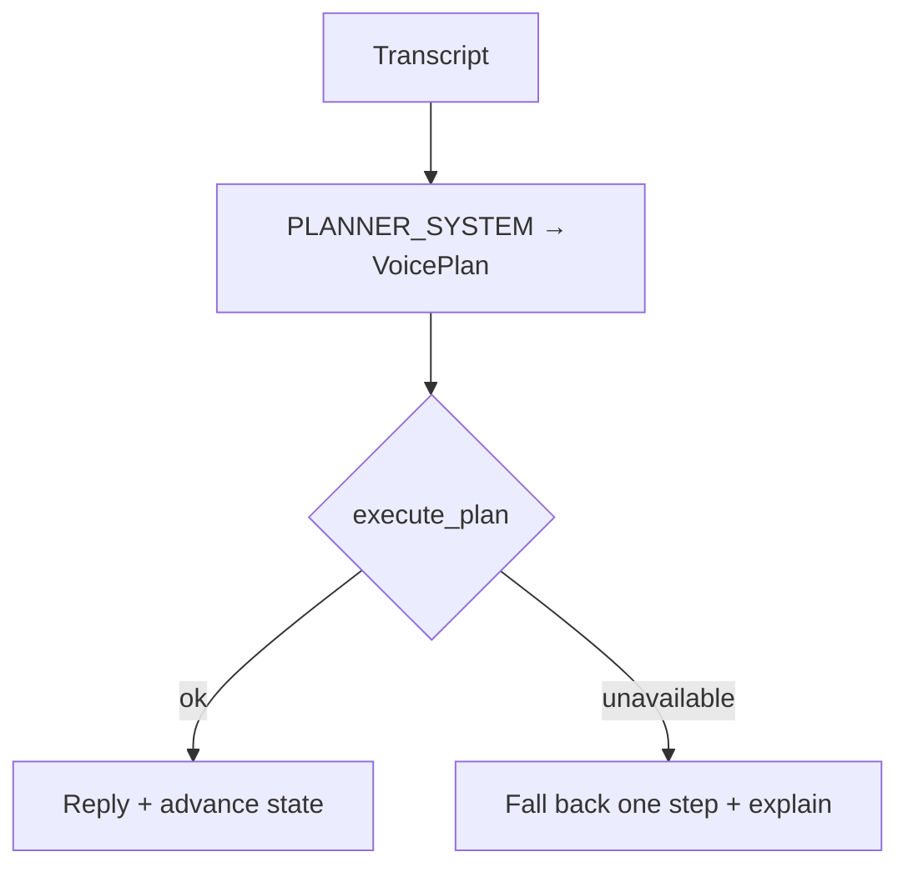
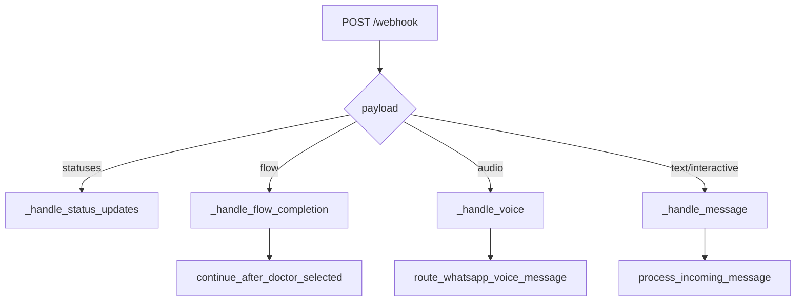
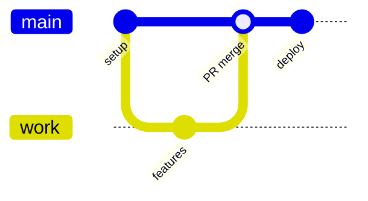
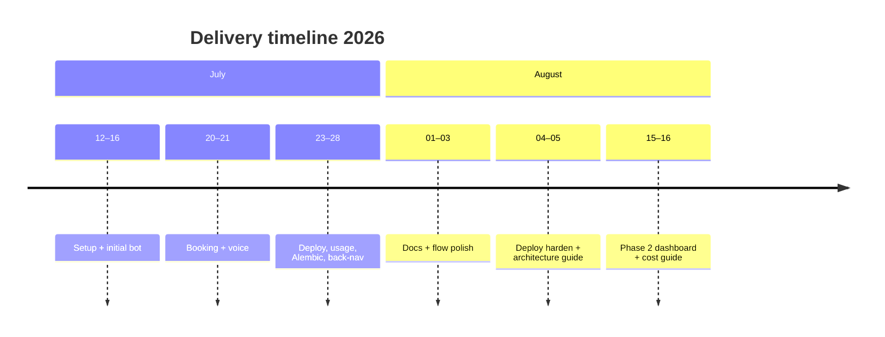

# Hospital Chatbot — Technical & Architecture Documentation

| | |
|:--|:--|
| **Version** | 5.2 |
| **Updated** | 2026-08-16 |
| **Repository** | [Ghena-A/hospital-chatbot](https://github.com/Ghena-A/hospital-chatbot) |
| **API** | FastAPI `1.0.0` — `uvicorn app.main:app` |
| **Related** | [`README.md`](../README.md) · [`DEPLOYMENT.md`](DEPLOYMENT.md) · [`COST.md`](COST.md) · `docs/pdf/DOCUMENTATION.pdf` |
| **Figures** | Architecture: `docs/images/fig01`–`fig12` · GUI: `docs/images/gui/` |

> **How to read this guide**  
> This is a **story of a promise**, then the machinery that keeps it.  
> **Act I — Why we built this:** §§1–5 (the problem, who we serve, how a visit feels, what the screens look like).  
> **Act II — The journeys we protect:** §§6–16 (architecture, booking, voice, safety).  
> **Act III — The system of record:** §§17–22 (database, dashboard, config, deploy, tests).  
> **Act IV — The words we give the model:** §§23–28 (prompts explained, Phase 2 changes, limitations, timeline, history, appendix).  
> Every flow picture has its own description underneath. Do not skip the captions.
>
> **Money lives elsewhere.** [`COST.md`](COST.md) is a short price comparison: what our models cost, what the alternatives cost, and what one dollar buys. Limitations, capacity, and voice latency stay **here**, in §25.

---

## Table of contents

Read in order. Section numbers **1–28** are the index; the acts are the story.

### Act I — Why we built this

1. [Why this exists](#1-why-this-exists)
   - 1.1 [The problem](#11-the-problem)
   - 1.2 [The promise](#12-the-promise)
   - 1.3 [What the product is](#13-what-the-product-is)
   - 1.4 [System context](#14-system-context)
2. [Requirements & Roles](#2-requirements-roles)
3. [Technology Stack](#3-technology-stack)
4. [A patient's day](#4-a-patients-day)
5. [What they actually see](#5-what-they-actually-see)

### Act II — The journeys we protect

6. [System Architecture](#6-system-architecture)
7. [Code Architecture](#7-code-architecture)
8. [Source Layout](#8-source-layout)
9. [Data Flow Architecture](#9-data-flow-architecture)
10. [Conversation Engine](#10-conversation-engine)
11. [Conversation Flows](#11-conversation-flows)
12. [Booking Architecture](#12-booking-architecture)
13. [Reschedule, Cancel, Hours & Holidays](#13-reschedule-cancel-hours-holidays)
14. [Reminders](#14-reminders)
15. [Voice: speaking instead of typing](#15-voice-speaking-instead-of-typing)
    - 15.1 [The promise](#151-the-promise)
    - 15.2 [The pipeline](#152-the-pipeline)
    - 15.3 [Components](#153-components)
    - 15.4 [Goals, next steps, and the furthest-justified rule](#154-goals-next-steps-and-the-furthest-justified-rule)
    - 15.5 [Why a voice reply can take 15 seconds](#155-why-a-voice-reply-can-take-15-seconds)
    - 15.6 [How to reduce voice latency](#156-how-to-reduce-voice-latency)
16. [Safety & Handover](#16-safety-handover)

### Act III — The system of record

17. [Database Design](#17-database-design)
18. [Admin Dashboard](#18-admin-dashboard)
19. [Configuration Architecture](#19-configuration-architecture)
20. [Startup, Webhook & API](#20-startup-webhook-api)
21. [DevOps & Deployment](#21-devops-deployment)
22. [Testing](#22-testing)

### Act IV — The words we give the model

23. [The words we give the model](#23-the-words-we-give-the-model)
    - 23.1 [Voice planner](#231-voice-planner--planner_system)
    - 23.2 [JSON input and output contract](#232-json-input-and-output-contract)
    - 23.3 [Intent classifier](#233-intent-classifier)
    - 23.4 [Choice mapper](#234-choice-mapper)
    - 23.5 [Language rules](#235-language-rules-patient-facing)
    - 23.6 [Receptionist persona (EN)](#236-receptionist-persona-en)
    - 23.7 [Receptionist persona (AR)](#237-receptionist-persona-ar)
24. [Phase 2 — what changed recently](#24-phase-2--what-changed-recently)
    - 24.1 [The shape of Phase 2](#241-the-shape-of-phase-2)
    - 24.2 [Real accounts, real roles](#242-real-accounts-real-roles)
    - 24.3 [Many clinics, one dashboard](#243-many-clinics-one-dashboard)
    - 24.4 [Who may see money](#244-who-may-see-money)
    - 24.5 [Conversion that cannot exceed 100%](#245-conversion-that-cannot-exceed-100)
    - 24.6 [The dashboard survives a closed window](#246-the-dashboard-survives-a-closed-window)
    - 24.7 [Schema and configuration changes](#247-schema-and-configuration-changes)
    - 24.8 [Known gaps after Phase 2](#248-known-gaps-after-phase-2)
25. [Limitations & how to make voice faster](#25-limitations--how-to-make-voice-faster)
    - 25.1 [What we actually run](#251-what-we-actually-run)
    - 25.2 [The real limits](#252-the-real-limits)
    - 25.3 [Capacity, honestly framed](#253-capacity-honestly-framed)
    - 25.4 [The 24-hour WhatsApp wall](#254-the-24-hour-whatsapp-wall)
    - 25.5 [Making a voice reply faster](#255-making-a-voice-reply-faster)
26. [Version Control & Timeline](#26-version-control-timeline)
27. [Document History](#27-document-history)
28. [Appendix](#28-appendix)

### List of figures

Each figure is a scene in the story. The meaning lives **under the image**, not only in this table.

| Fig | Title | What it is saying | File |
|:---:|:------|:------------------|:-----|
| 1 | System context | One patient, one clinic number, one truth in PostgreSQL | `images/fig01-system-context.png` |
| 2 | Layered code architecture | Rules flow downward; WhatsApp never owns the booking | `images/fig02-layered-architecture.png` |
| 3 | Webhook message routing | Every ping is classified: text, voice, flow, or a delivery receipt | `images/fig03-webhook-routing.png` |
| 4 | Booking flow | From “I need a doctor” to a reference in the patient’s pocket | `images/fig04-booking-flow.png` |
| 5 | Voice pipeline | Speak → hear → plan → **prove** against the live schedule | `images/fig05-voice-pipeline.png` |
| 6 | Slot hold & confirm | Three minutes of honesty so two families never share one chair | `images/fig06-hold-confirm.png` |
| 7 | Core data model | Tenant → clinic → people, slots, and the audit of every change | `images/fig07-data-model.png` |
| 8 | Deploy pipeline | A merge to `main` is a promise to the production clinic | `images/fig08-deploy-pipeline.png` |
| 9 | Conversation states | We remember where we left the patient — until they say MENU | `images/fig09-conversation-states.png` |
| 10 | Reminders & handover | We nudge before the visit; we never abandon a human in need | `images/fig10-reminders-handover.png` |
| 11 | Configuration architecture | Knobs in `.env` and per-clinic settings, never hard-coded panic | `images/fig11-config-architecture.png` |
| 12 | Admin dashboard map | Staff see the same appointments the patient just confirmed | `images/fig12-admin-dashboard.png` |
| G1–G19 | Live WhatsApp | The patient's side, exactly as it arrives on their phone | `images/gui/wa-*.png` (§5.1–§5.5) |
| G20–G30 | Live dashboard | The clinic's side after Phase 2 — role badge, clinic selector, every operational screen | `images/gui/dash-*.png` (§5.6) |
| G31–G32 | Users & Clinics | Accounts, roles, and multi-clinic administration | under §24.3 |
| G33–G34 | Ops | A green deploy and the server behind the clinic number | under §21 |
| C1–C3 | Usage & spend screens | What listening cost, and who is allowed to see it | [`COST.md`](COST.md) §1, §7 |

---

## 1. Why this exists

### 1.1 The problem

A clinic chair is a scarce thing. Around it sit two kinds of exhaustion.

The **patient** has already waited: on hold, in a corridor, in a WhatsApp chat that died because typing “الثلاثاء الساعة اتنين مع دكتور نور الدين” on a small keyboard is work. Some people cannot type their dialect. Some are holding a child. Some hang up.

The **receptionist** has already answered the same three questions a hundred times today — is the doctor in, is that slot free, can you change Thursday — while two people, in good faith, were promised the **same** 2:00 p.m.

This product exists because that collision is not a “nice-to-have chatbot.” It is lost care, double-booked rooms, and a person who needed a doctor and got a busy tone instead.

### 1.2 The promise

We meet the patient where they already live: **WhatsApp**. They may tap buttons. They may type. They may **speak**. Arabic or English. We will not invent a free time. We will hold a chair for three minutes so they can confirm. We will put a reference in their pocket. We will remind them before they forget. If the words are medical, urgent, or simply “I need a human,” we will not fake competence — we will **hand over**.

The clinic sees the same truth the patient does. One PostgreSQL. No shadow diary.

### 1.3 What the product is

Hospital Chatbot is a WhatsApp Cloud API backend for clinic appointment operations. Patients can:

- Book, reschedule, and cancel appointments
- Search by specialty or doctor name
- Ask about doctors / specialties
- Send voice notes (Whisper STT + GPT planner)
- Escalate to reception (handover)

Arabic and English are supported. Clinic staff use a Streamlit admin dashboard against the **same PostgreSQL** database.

**How the API process starts (not the patient menu):** `uvicorn app.main:app`

The **patient’s** single door is the WhatsApp **main menu**. Those two “entry points” are not the same thing.

| Interface | Capabilities |
|:----------|:-------------|
| Patient (WhatsApp) | Text, buttons, lists, doctor cards, optional Flow, voice |
| Admin (Streamlit) | Clinic/doctor/hours, appointments, conversations, reminders, KPIs, usage |

### 1.4 System context


**Figure 1 — System context**

This is the whole village in one picture. The patient never talks to our servers directly. They talk to WhatsApp. Meta delivers the message. FastAPI decides. PostgreSQL remembers. OpenAI is invited **only** to hear and to plan — never to invent a slot. Streamlit sits on the same database so a receptionist is not looking at a different reality.

| | |
|:--|:--|
| **The problem it solves** | Fragmented channels: phone, paper, a bot that does not know the diary. |
| **What happens** | WhatsApp ↔ Meta Cloud API ↔ FastAPI (`:8000`) ↔ engine & services ↔ PostgreSQL. OpenAI for voice/LLM. Streamlit (`:8501`) for staff. |
| **What to notice** | One database. Admin and bot share it. Voice is a path **into** the same backend, not a second product. |
| **Patient sees** | A clinic WhatsApp thread. Nothing else. |



---

## 2. Requirements & Roles

These are not a shopping list. They are the minimum we owe a person who is already unwell enough to need an appointment.

### 2.1 Product requirements

| Requirement | Description |
|:------------|:------------|
| Book | Specialty or doctor → date → time → patient details → confirm → reference |
| Reschedule | Pick upcoming appointment → new date/time → confirm; refresh reminders |
| Cancel | Pick appointment → confirm; release slot; cancel reminders |
| Search specialty / doctor | Paginated lists (WhatsApp max 10 rows + **More**) |
| Inquiry | Browse doctors/specialties; may continue into booking |
| Voice | Voice note → STT → plan → same guided flows |
| AR / EN | Language follows patient; greetings can switch language |
| Handover | Reception transfer + context; safety wording escalates |
| Reminders | e.g. 24h and 2h before; CLI worker |
| Admin dashboard | Full clinic ops on production DB |

Supporting rules:

- Interactive WhatsApp UI with free-text fallback
- Double-booking protection (hold + row lock + unique active appointment)
- Global nav: `MENU` / قائمة · Back / رجوع / عودة / `Return`
- Holidays and doctor leave block slots

### 2.2 Roles

| Role | How they use the system |
|:-----|:------------------------|
| **Patient** | WhatsApp clinic number — book / change / cancel / inquire / voice / handover |
| **Receptionist** | Gets `HandoverCase` context; optional WhatsApp notify via `RECEPTIONIST_WHATSAPP` |
| **Admin / staff** | Streamlit dashboard — clinic, doctors, hours, appointments, transcripts, KPIs, usage |

---

## 3. Technology Stack

| Layer | Technology | Role |
|:------|:-----------|:-----|
| API | FastAPI + Uvicorn | Webhook + booking REST |
| DB | PostgreSQL + SQLAlchemy 2 + psycopg | Persistence |
| Migrations | Alembic | Schema versioning |
| Conversation | LangGraph-style engine + langchain-* | State machine |
| Messaging | Meta WhatsApp Cloud API | Inbound / outbound |
| HTTP | `requests` | Meta API + media download |
| Config | `python-dotenv` | `.env` loading |
| AI | OpenAI Whisper + GPT | Voice + choice help + intent |
| Language | `lingua-language-detector` | AR/EN detection support |
| Schemas | Pydantic | Booking API models |
| Images | Pillow | Doctor Flow / cards |
| Dashboard | Streamlit + pandas | Admin UI |
| CI/CD | GitHub Actions + SSH | Deploy to Windows |
| Tunnel (local) | cloudflared / ngrok | Meta webhook testing |

Dependencies: `requirements.txt`.

---

## 4. A patient's day

Imagine the clinic number is already in their phone. They open WhatsApp because that is where family already talks. The bot does not demand an app store. It asks, one step at a time, and it lets them go **Back** or type **MENU** when life interrupts.

### Book

1. Message the clinic on WhatsApp.  
2. Choose **Book appointment**.  
3. Specialty **or** doctor name → pick doctor.  
4. Date → time (use **More** / المزيد if needed).  
5. Enter full triple name (DOB only if asked).  
6. Confirm → receive reference.  

Tips: `MENU` / قائمة · رجوع / `Back`. Prefer list picks for dates/times.

### Reschedule

1. **Reschedule appointment** → pick upcoming appt.  
2. Choose what to change → new date/time → confirm.  
3. Reminders refresh. Too close to time → may hand over to reception.

### Cancel

1. **Cancel appointment** → select → confirm.  
2. Reminders stop. Late cancel may hand over.

### Voice

1. Send a voice note.  
2. Bot transcribes and continues the guided flow when possible.  
3. If unclear, follow the next buttons/prompts.

### Reception

Choose **Talk to reception**, or follow a handover prompt. Staff see context in the dashboard.

### Admin

Open dashboard URL → sign in → manage clinic, doctors, appointments, conversations, reminders, KPIs, usage.

---

## 5. What they actually see

These are live product screenshots, not mockups. Files live under `docs/images/gui/`.  
To add more later: drop PNGs into that folder and reference them here (then re-run `python docs/_export_pdf.py`).

Each picture below is a beat in the patient’s story: what they tapped, what the bot answered, what happens next.

### 5.1 WhatsApp — main menu & handover


**Figure G1 — The door**

Five honest choices. Not a maze. Book, reschedule, cancel, ask about doctors, or talk to a human. The list button is always there. In this frame the patient starts **Cancel** — they already have a life that changed.

| | |
|:--|:--|
| **What they tapped** | Main menu; then Cancel appointment. |
| **What the bot does** | Offers the five menu actions; cancel begins the “pick your visit” list. |
| **Next beat** | Upcoming appointments (G11) or handover if they asked for reception (G2). |


**Figure G2 — A human, on purpose**

When the bot should not guess, it stops. “Talk to reception” is not failure. It is respect: the thread, the context, and the case wait for staff.

| | |
|:--|:--|
| **What they tapped** | Talk to reception. |
| **What the bot does** | Acknowledges handover; stores a `HandoverCase`; may notify `RECEPTIONIST_WHATSAPP`. |
| **Next beat** | Staff open the dashboard conversation. The bot does not keep pretending. |

### 5.2 WhatsApp — booking


**Figure G3 — Two ways to the same chair**

Some people know the specialty (“قلب”). Some know the name. We do not force a call-center script. Both paths meet at a real doctor and a real time.

| | |
|:--|:--|
| **What they tapped** | Book appointment, then By specialty **or** By doctor name. |
| **What the bot does** | Opens the matching list (paginated, WhatsApp max 10 rows + More). |
| **Next beat** | A doctor card (G4), then dates and times. |


**Figure G4 — A face before a timeslot**

A booking is not a SKU. The card shows who they will sit with: photo, title, specialty. Optional WhatsApp Flow can swipe a few portraits; otherwise we send cards in sequence.

| | |
|:--|:--|
| **What they tapped** | A doctor from the list, or **Choose** on the card. |
| **What the bot does** | Locks that doctor into the draft and offers available days. |
| **Next beat** | Date → time → hold (Figure 6). |


**Figure G5 — We remember the name**

The phone is the key. If this number already belongs to a patient, we ask: same person, or did the name change? We do not silently book for the wrong soul.

| | |
|:--|:--|
| **What they tapped** | Same patient **or** Name changed. |
| **What the bot does** | Reuses the record, or asks for a new triple name. |
| **Next beat** | Summary (G6 / G7). |


**Figure G6 — Look once, in Arabic**

Before we spend a chair, we show the whole sentence: who, when, with whom. Confirm or walk away.

| | |
|:--|:--|
| **What they tapped** | Reached summary after name. |
| **What the bot does** | Shows Confirm / Cancel on the held slot (still held for **3 minutes**). |
| **Next beat** | Confirmed + reference (G8), or the hold expires and the time returns to the clinic. |


**Figure G7 — The same promise, in English**

Language follows the patient. The facts do not change: doctor, day, time, then a human confirm.

| | |
|:--|:--|
| **What they tapped** | Summary in an English thread. |
| **What the bot does** | Same confirm gate as G6. |
| **Next beat** | G8. |


**Figure G8 — A reference in the pocket**

This is the moment the promise becomes a record: appointment reference (`APT-YYYYMMDD-XXXX`), doctor, when, and a map so they can actually arrive. Reminders are born here (24h and 2h).

| | |
|:--|:--|
| **What they tapped** | Confirm. |
| **What the bot does** | `confirm_booking` — slot `booked`, appointment row, history, reminders. |
| **Next beat** | They may reschedule or cancel from the menu while the cutoff still allows it. |

### 5.3 WhatsApp — reschedule


**Figure G10 — Life changed; the chair can move**

Reschedule is not a new booking from zero. We start from **their** upcoming visits.

| | |
|:--|:--|
| **What they tapped** | Reschedule appointment. |
| **What the bot does** | Lists upcoming appointments owned by this WhatsApp phone. |
| **Next beat** | Pick one (G11). Too close to the visit (default **2 hours**) → handover, not a silent change. |


**Figure G11 — Yours, not the whole clinic**

The list is theirs. Phone ownership is the lock. Staff identifiers live in the dashboard; the patient sees human labels and the appointment reference.

| | |
|:--|:--|
| **What they tapped** | An upcoming visit in the WhatsApp list. |
| **What the bot does** | Selects that appointment as the one to change. |
| **Next beat** | What to change (G12). |


**Figure G12 — One question, not a new interrogation**

Inside reschedule we ask **what** to change: time, day, or doctor. That is a step, not a main-menu item. The menu still says **Reschedule**.

| | |
|:--|:--|
| **What they tapped** | Change time / Change day / Change doctor. |
| **What the bot does** | Routes to slots, dates, or the doctor list. |
| **Next beat** | Pick a new time (G13) or a new day/doctor. |


**Figure G13 — Only times that are still free**

We do not offer a ghost. The list is live availability after holds, leave, and holidays.

| | |
|:--|:--|
| **What they tapped** | A clock time (More if the day is long). |
| **What the bot does** | Holds or stages the new slot and shows a summary. |
| **Next beat** | Confirm the update (G14). |


**Figure G14 — Say it twice so nobody is surprised**

Old chair released, new chair taken, reminders rebuilt — but only after Confirm.

| | |
|:--|:--|
| **What they tapped** | Confirm on the update summary. |
| **What the bot does** | Transactional reschedule + reminder refresh. |
| **Next beat** | Updated message + map (G15). |


**Figure G15 — The new when, with a way to get there**

The story of the visit continues; only the clock (or the doctor) changed.

| | |
|:--|:--|
| **What they tapped** | (Result screen.) |
| **What the bot does** | Shows the new facts and map. |
| **Next beat** | Reminders now point at the new time. |

### 5.4 WhatsApp — cancel


**Figure G16 — Cancelling is a decision, not a slip**

We show the visit and ask once more. Back is still allowed. We do not “release” in the patient’s language — we cancel the appointment, and the time becomes free again.

| | |
|:--|:--|
| **What they tapped** | An appointment, then this confirm screen. |
| **What the bot does** | Waits for Confirm cancel or Back. |
| **Next beat** | Details (G17) then done (G18). Within **2 hours** of the visit → handover instead. |


**Figure G17 — Name the thing we are about to let go**

Reference, doctor, date, time. No vague “are you sure?”

| | |
|:--|:--|
| **What they see** | Cancellation summary. |
| **What the bot does** | Last chance to keep the chair. |
| **Next beat** | G18. |


**Figure G18 — The chair returns to the clinic**

The slot is available for someone else. Reminders stop. The patient may book again or return to the menu. Dignity, not a dead end.

| | |
|:--|:--|
| **What they tapped** | Confirm cancel. |
| **What the bot does** | Cancels appointment, frees slot, cancels reminders. |
| **Next beat** | Book again / Menu. |

### 5.5 WhatsApp — voice


**Figure G19 — They spoke. We did not make them type.**

This is the heart of the voice story: a voice note, a transcript, a plan, then the **same** hold-and-name funnel as a tap. No robot voice back. Buttons they can trust.

| | |
|:--|:--|
| **What they sent** | A WhatsApp voice note (e.g. doctor + day + time). |
| **What the bot does** | Whisper → planner (`PLANNER_SYSTEM`) → executor checks the DB → holds the slot if it is real → asks for the patient name. |
| **Next beat** | Same summary/confirm as typing. Full pipeline: Figure 5 and §15–§23. |

### 5.6 Admin dashboard (Streamlit)

The other half of the promise: the clinic is not flying blind. Every screenshot below is the **current** dashboard, after Phase 2 — signed in as `admin@demo.local` with the `company_admin` badge under the email, and one clinic selected in the sidebar.


**Figure G20 — Did we help, and where did we lose people?**

The sidebar is the clinic's map of the same world: language, the signed-in account and its role, the clinic selector, then every operational screen. The body is the answer to “is this working?” for the period the clinic chooses.

| | |
|:--|:--|
| **What staff open** | KPIs, Clinic setup, Departments, Doctors, Working hours, Doctor schedule, Appointments, Conversations, Reminders, Settings — plus Usage / costs, Users, and Clinics, which only a company admin sees. |
| **What this capture says** | 9 conversations, 24 booking attempts, 19 confirmed, **79.2 % conversion**, 5 cancelled, 9 rescheduled, 0 no-shows, 0 failed intents, 116 voice notes over 7.45 minutes, 8 open handovers. |
| **What to notice** | Conversion is now confirmed ÷ attempts and **cannot exceed 100 %** (§24.5). The three spend metrics on this screen are visible here only because this account is a company admin (§24.4). |


**Figure G21 — Name, number, timezone, language, map.** The identity the patient hears, plus the Google Maps URL that becomes the short link in a confirmation. Wrong timezone is a wrong clock.


**Figure G22 — Specialties in two languages.** The nine departments behind “By specialty” — Cardiology through OB/GYN — each with EN and AR names and an `active_flag` the bot respects.


**Figure G23 — The people patients ask for by name.** EN/AR names, title, specialization, and both bios. This table is what makes “عايز دكتور نور الدين” resolvable.


**Figure G24 — Bilingual by construction.** Name AR, Name EN, title, specialization, both bios, photo URL. A doctor added here is bookable on WhatsApp without a deploy.


**Figure G25 — When a doctor is actually in the building.** Weekday, start, end, slot length, max bookings — and a second tab for holidays and leave. Slots are generated from this after save; the bot may only offer what these rows allow.


**Figure G26 — Free, booked, held, blocked.** 48 free and nothing booked for this doctor in the next 14 days. Held is the three-minute promise in motion; blocked is leave or holiday, and we will not sell those hours. Confirmed slots stay hidden from WhatsApp until cancelled.


**Figure G27 — Every visit, with its reference.** `APT-YYYYMMDD-XXXX`, status, patient, phone, doctor, specialty, slot start/end, slot status, timestamps. Filter by status. This is the diary the WhatsApp thread wrote.


**Figure G28 — Where a handover lives.** State, current intent, patient, last update — and the transcript below, message by message with direction and delivery status. Reception never starts from zero.


**Figure G29 — Two knocks per appointment, queued.** `24h_before` and `2h_before` rows with `scheduled_at`, `sent_at`, status, and `template_name = appointment_reminder`. **Process due**, **Force all pending**, and **Retry failed** are the operator's controls.

| | |
|:--|:--|
| **What to notice** | Every row here is `pending` with `retry_count = 0`. A row whose scheduled time is more than 24 hours after the patient's last message cannot be delivered as free-form text — that is the WhatsApp template wall of §14 and §25.4, not a worker bug. |


**Figure G30 — Policy without a redeploy.** Reminder hours (`24,2`), reminder template name, escalation WhatsApp number, fallback wording, and consent text — stored per clinic.

The **Usage / costs** and **Recent usage logs** screens belong to the money story, so they live with the money: see [`COST.md`](COST.md) §1 (Figures C1–C2) for those screenshots and what every column means. The two company-admin management screens, **Users** and **Clinics**, are shown where they are explained: §24.3.

## 6. System Architecture

### 6.1 High-level components

The village from Figure 1 again, now as a contract: WhatsApp is the street, FastAPI is the door, services are the clerks, PostgreSQL is the ledger.

> See **Figure 1** in §1.4 — same picture, same meaning.

### 6.2 Separation of responsibilities

| Path | Responsibility |
|:-----|:---------------|
| `app/api/routes` | HTTP + Meta payload extraction |
| `app/graph` | Conversation state & interactive steps |
| `app/services` | Business logic |
| `app/models` | SQLAlchemy tables |
| `app/schemas` | Pydantic API schemas |
| `app/core` | Config, i18n, safety, time helpers |
| `app/language` | Detect / sync / prompts / validation |
| `app/db` | Engine, sessions, enums |
| `dashboard` | Admin UI |
| `alembic` | Migrations |
| `.github/workflows` | CI/CD |

### 6.3 Design principles

- Business rules live in **services**, not in the WhatsApp client.
- Interactive UI guides choices; free text still works for navigation and matching.
- Alembic owns schema changes on deploy.
- Voice is an alternate **input** into the same booking conversation — not a separate product.
- Draft booking details use an in-memory session map (lost on process restart); durable state is on `Conversation` in PostgreSQL.

---

## 7. Code Architecture

### 7.1 Layered view


**Figure 2 — Layered code architecture**

Passion without discipline becomes a bot that lies. These seven layers exist so a WhatsApp button can never quietly invent a doctor. Entry, transport, orchestration, domain services, language, persistence, cross-cutting config/safety. Dependencies point **down**.

| | |
|:--|:--|
| **The problem it solves** | Business rules leaking into the chat UI, then drifting from the diary. |
| **What to notice** | `routes → graph → services → models/db`. Dashboard talks to services/DB, not to Meta. |
| **What it is not** | A second brain. Voice modules sit in **services**, same as booking. |

**Allowed dependency direction**

```text
routes → graph → services → models/db
                ↘ language
                ↘ core/config
services → whatsapp_client (outbound IO)
dashboard → admin_dashboard_service → models/db
```

### 7.2 Service map

| Module | Responsibility |
|:-------|:---------------|
| `whatsapp_client.py` | Outbound Meta API: text, buttons, lists, cards, flow |
| `conversation_service.py` | Get/create conversation, state/language, message log |
| `booking_service.py` | Hold / confirm / reschedule / cancel / release holds |
| `slot_service.py` | Generate & list slots; holidays & leave |
| `doctor_service.py` | Departments, doctors, specialty match, cards |
| `patient_service.py` | Name validation; find/create by phone |
| `intent_service.py` | Rules + OpenAI intent |
| `choice_resolver.py` | Free-text → list option (rules + LLM) |
| `flow_service.py` | WhatsApp Flow doctor picker |
| `reminder_service.py` | Create / cancel / process due reminders |
| `handover_service.py` | Create handover; notify receptionist |
| `clinic_settings_service.py` | Maps / location from DB + env |
| `admin_dashboard_service.py` | KPIs, CRUD, settings, usage |
| `dashboard_service.py` | Read-side appointments / conversations |
| `voice_service.py` | STT + route entry |
| `voice_prompts.py` | `PLANNER_SYSTEM` |
| `voice_schemas.py` | `VoicePlan` types |
| `voice_executor.py` | Execute plan vs DB |
| `voice_fastpath.py` | V1 mid-flow shortcuts |
| `voice_cost.py` | Cost estimates / logs |

### 7.3 Intent enum

`app/services/intent_service.py`:

`book` · `update` · `cancel` · `ask_doctors` · `handover` · `menu` · `confirm` · `thanks` · `unknown`

---

## 8. Source Layout

```text
hospital-chatbot/
├── app/
│   ├── main.py
│   ├── api/routes/          webhook.py, booking.py
│   ├── graph/               conversation_engine.py
│   ├── core/                config, i18n_bot, safety, time_format
│   ├── language/            detect, prompts, validation
│   ├── services/            domain + voice_*
│   ├── models/              SQLAlchemy tables
│   ├── schemas/booking.py
│   ├── db/                  database.py, enums.py
│   ├── flows/doctor_picker.json
│   └── scripts/             run_reminders, seed_*
├── alembic/versions/
├── dashboard/               streamlit_app.py, ui_i18n.py
├── tests/
├── .github/workflows/deploy.yml
├── docs/
├── requirements.txt
├── .env.example
└── README.md
```

### Models by file

| File | Tables |
|:-----|:-------|
| `core_models.py` | `tenants`, `clinics`, `departments`, `clinic_holidays` |
| `doctor_models.py` | `doctors`, `doctor_locations`, `doctor_working_hours`, `doctor_unavailability` |
| `patient_models.py` | `patients` |
| `appointment_models.py` | `appointment_slots`, `appointments`, `appointment_history` |
| `conversation_models.py` | `conversations`, `messages`, `voice_messages` |
| `reminder_models.py` | `reminders` |
| `handover_models.py` | `handover_cases` |
| `usage_models.py` | `usage_logs` |
| `admin_models.py` | `admin_users`, `config_settings` |

### Key files

| File | Role |
|:-----|:-----|
| `app/main.py` | FastAPI app |
| `app/api/routes/webhook.py` | Meta webhook |
| `app/graph/conversation_engine.py` | Conversation core |
| `app/services/booking_service.py` | Hold / confirm / change |
| `app/services/voice_*.py` | Voice pipeline |
| `app/core/config.py` | All env settings |
| `dashboard/streamlit_app.py` | Admin UI |
| `.github/workflows/deploy.yml` | Auto-deploy |

---

## 9. Data Flow Architecture

### 9.1 End-to-end path

```text
Patient → WhatsApp → Meta Cloud API
  → FastAPI POST /webhook
  → Conversation engine (persist → handle)
  → Domain services
  → PostgreSQL
  → whatsapp_client → Meta → Patient
```

### 9.2 WhatsApp inbound sequence



### 9.3 Booking hold → confirm


**Figure 6 — Three minutes of honesty**

Two families must never be given the same chair. When a patient picks a time, we **hold** it (`SELECT FOR UPDATE`) for `SLOT_HOLD_MINUTES` (default **3**). Confirm turns hold into a booked appointment and creates reminders. If they walk away, the hold expires and the clinic can offer that hour again.

| | |
|:--|:--|
| **The problem it solves** | Double-booking under concurrent WhatsApp taps. |
| **Statuses** | `available` → `held` → `booked`. Also `blocked` (leave/holiday), `expired`. |
| **What to notice** | Unique active appointment per slot. The clock on the hold is a product fact, not a slogan. |

### 9.4 Voice pipeline


**Figure 5 — They spoke. We prove it.**

This is the voice story in one line of boxes. A voice note is not a second bot. It is another way to enter the **same** booking funnel.

| | |
|:--|:--|
| **The problem it solves** | Typing friction, dialect, drop-off — a person who can speak but will not type. |
| **What happens** | Voice note → Meta download → Whisper STT → GPT + `PLANNER_SYSTEM` → executor against PostgreSQL. |
| **What to notice** | The planner **proposes**. Python **proves**. If `VOICE_ROUTER_V2` is off, V1 fastpath still lands in the engine. |
| **Patient sees** | Text and buttons. Never a robot voice. |

The full meaning of the planner’s words is Act IV (§23.1). The engineering of this pipe is §15.

### 9.5 Reminders


**Figure 10 — We nudge. We never abandon.**

Left: after confirm, we schedule reminders (default 24h and 2h) and a worker sends them. Right: when the patient asks for a person, when the words are medically dangerous, when cancel/reschedule is too late, or when the webhook itself fails — we create a handover, not a shrug.

| | |
|:--|:--|
| **The problem it solves** | No-shows from forgotten visits; bots that trap people who needed a receptionist. |
| **What to notice** | A reminder sent more than 24 hours after the patient's last message needs an approved WhatsApp **template**, which the sender does not use yet — see §14 and §25.4. Handover is a first-class case in the dashboard. |

### 9.6 Admin → DB


**Figure 12 — Staff stand in the same story**

Every Streamlit screen is a window onto PostgreSQL. Login is a password; after that, KPIs, clinic, doctors, hours, appointments, conversations, reminders, usage. If the bot confirmed it, the dashboard can see it.

| | |
|:--|:--|
| **The problem it solves** | A shadow spreadsheet that disagrees with WhatsApp. |
| **What to notice** | Same DB as Figure 1. Not a second source of truth. |

---

## 10. Conversation Engine

This is how we refuse to forget the last thing they said. One package walks the graph; PostgreSQL keeps the room they are in; a small in-memory map holds the pencil draft.

**Package:** `app/graph/conversation_engine.py`

| Concept | Detail |
|:--------|:-------|
| Public API | `process_incoming_message`, `continue_after_doctor_selected` |
| Graph | `build_graph()` — `node_persist_inbound` → `node_handle` → END |
| GraphState | `phone`, `text`, `payload_id`, `message_type`, `db_session`, `conversation_id`, `conversation_state`, `language`, `keep_language`, `handled` |
| Durable state | `Conversation.state` |
| Ephemeral draft | `_SESSION[phone]` via `_sess(phone)` |

### Persisted states (`ConversationState`)

`new` · `language_select` · `main_menu` · `booking_doctor` · `booking_date` · `booking_slot` · `patient_details` · `confirming` · `reschedule` · `cancel` · `handover` · `closed`

### In-memory `awaiting` substeps (examples)

`department` · `doctor` · `date` · `slot` · `patient_name` · `known_patient_confirm` · `dob_gate` · `dob_value` · `summary` · `confirm` · `pick_appointment` · `change_type` · `no_slots_alt` · `inquiry_book_cta` · `post_cancel` · `voice_confirm`


**Figure 9 — We remember where we left them**

A conversation is a journey with a door (main menu) and rooms (book, reschedule, cancel, handover). Durable `Conversation.state` lives in PostgreSQL. The draft in `_SESSION[phone]` is the pencil in the margin — doctor, date, slot, awaiting — and it **vanishes if the process restarts**. That is a limitation we name, not a surprise.

| | |
|:--|:--|
| **The problem it solves** | Asking “which specialty?” again after they already chose a doctor. |
| **What to notice** | MENU clears the draft. Back walks one sensible step. Language select can be skipped when we already know. |

---

## 11. Conversation Flows

This is the plot of Act I in engineering clothes. Arabic and English. Short greetings (`Hi` / `Hello` / مرحبا) can switch language when the opening is clear. The main menu is the **patient’s** single door — not the API process start.

### Main menu

| # | Option |
|:-:|:-------|
| 1 | Book appointment |
| 2 | Reschedule appointment |
| 3 | Cancel appointment |
| 4 | Ask about doctors/specialties |
| 5 | Talk to reception |

### Global navigation

| Action | Triggers | Behavior |
|:-------|:---------|:---------|
| Main menu | `MENU`, قائمة, منيو | Clear draft → main menu |
| Step back | رجوع, عودة, `Back`, `Return` | One sensible step back |

Back is state-aware (time → date → doctor → path choice). Cancellation confirm is separate from global back.

### Book appointment

**Path choice:** By specialty **or** by doctor name.

WhatsApp lists allow max **10 rows**. Longer lists append **More** / المزيد and send the next page as a new list.

| Step | Behavior |
|:-----|:---------|
| Date | Available dates (paginated). Invalid typed day → re-offer list |
| Time | Slots + **Change day**. Invalid typed time → re-offer list |
| Patient details | Reuse known name or ask triple name; DOB if `REQUIRE_DOB` |
| Confirm | Summary → confirm → reference |

**Patient name rules:** at least three letter parts (AR/EN), optional internal hyphen (`El-Din`), each part ≥ 2 letters — no digits/emoji/punctuation.

**Free-text matching:** rules then LLM via `choice_resolver`. Date/time matching is strict — “is 7 available?” must not silently pick another slot.


**Figure 4 — From “I need a doctor” to a reference**

This is the happy path of Act I, drawn as engineering. Menu → specialty **or** name → doctor → day → time (hold) → name → confirm → reference + reminders. Every later chapter (hold, voice, prompts) is how we refuse to skip a box or invent one.

| | |
|:--|:--|
| **The problem it solves** | A free-text void where patients get lost. |
| **What to notice** | Hold sits **before** confirm. The reference is the ending, not the beginning. |
| **Also see** | Screens G3–G8; protection in Figure 6. |

### Reschedule / Cancel / Inquiry / Handover

- **Reschedule:** list upcoming → pick → change type → new date/slot → confirm; reminders refreshed.
- **Cancel:** list → confirm → release slot; cancel reminders.
- **Inquiry:** browse doctors/specialties; CTA into booking.
- **Handover:** acknowledge; store context; notify reception when configured.

---

## 12. Booking Architecture

### Specialty / doctor selection

- Departments = specialties (paginated).
- Doctor-by-name uses `list_active_doctors` + session offsets.
- Cards: `doctor_card_payload` + `send_doctor_cards` (typically up to 5).
- Optional Flow: `flow_service` + `app/flows/doctor_picker.json` (fallback to cards).
- Bulk test seed: `python -m app.scripts.seed_bulk_test`.

### Slots

- `get_available_dates_and_slots` validates doctor and releases expired holds.
- `ensure_slots_for_doctor` generates from weekly hours.
- Excludes past times, `MIN_LEAD_HOURS`, leave, clinic holidays.

### Hold & confirm (code)

```python
# app/services/booking_service.py
def hold_slot(db, *, slot_id, clinic_id, held_by_phone=None, hold_minutes=None, ...):
    """Temporarily hold a slot before confirmation."""
    minutes = SLOT_HOLD_MINUTES if hold_minutes is None else hold_minutes
    slot = get_slot_for_update(db, slot_id)  # SELECT FOR UPDATE
    if not slot or slot.clinic_id != clinic_id:
        raise BookingError("Slot not found")
    # status = held, hold_expires_at = now + minutes, owner = phone


def confirm_booking(db, *, tenant_id, clinic_id, whatsapp_phone,
                    patient_name, doctor_id, slot_id, ...):
    """Lock slot → Patient + Appointment(confirmed) → history → reminders."""
    slot = get_slot_for_update(db, slot_id)
    ...
```

### Double-booking protection

> See **Figure 6** in §9.3 — the same three-minute hold, now as code.

1. `SELECT FOR UPDATE` on slot row  
2. Exclude non-available slots from offers  
3. Partial unique index on active appointments for a slot  

| Slot status | Bookable? |
|:------------|:----------|
| `available` | Yes |
| `held` | No |
| `booked` | No |
| `blocked` | No |
| `expired` | No |

---

## 13. Reschedule, Cancel, Hours & Holidays

Life changes. Doctors take leave. The clinic closes for a holiday. We still owe the patient a true calendar — and we will not let them cancel two minutes before the visit without a human.

- Ownership tied to WhatsApp phone.
- Cutoffs: `CANCEL_CUTOFF_HOURS` / `RESCHEDULE_CUTOFF_HOURS` — too late → handover.
- History rows + reminder cancel/recreate are transactional.

| Concept | Model |
|:--------|:------|
| Weekly hours | `DoctorWorkingHours` → generates slots |
| Doctor leave | `DoctorUnavailability` → overlapping slots `blocked` |
| Clinic holiday | `ClinicHoliday` → block across doctors |



---

## 14. Reminders

A confirmed visit is easy to forget when life is loud. We write two knocks on the door — by default **24 hours** and **2 hours** before — then a worker sends them.

- Created at booking: offsets from `REMINDER_HOURS_BEFORE` (default 24h, 2h).
- Type string pattern: `{hours}h_before` (e.g. `24h_before`).
- Rows carry `template_name="appointment_reminder"`, but `process_due_reminders()` sends a **free-form interactive button message** (`wa.send_buttons`) with Reschedule / Cancel / MENU.
- Worker: `python -m app.scripts.run_reminders` (`--dry-run`, `--force`, `--limit`, `--loop` supported).
- Cancel/reschedule clears pending reminders; a failed send sets `status=failed` and increments `retry_count`.
- Meta delivery receipts update status via webhook statuses handler.

**The 24-hour wall.** WhatsApp only accepts free-form business messages inside the 24-hour customer-service window that each inbound patient message opens. A booking made days ahead means the `24h_before` reminder — and usually the `2h_before` one too — falls **outside** that window, where Meta requires a pre-approved, **paid** template. There is no `send_template()` in the WhatsApp client yet, so those sends fail structurally rather than transiently: retrying will not fix them.

What that means for the roadmap — template approval, `send_template()`, funding the WhatsApp account, and the per-appointment budget line — is §25.4. Reminders sent *inside* the window, for example right after a booking or when the patient replies to a nudge, are free-form and free.

---

## 15. Voice: speaking instead of typing

### 15.1 The promise

Some patients will never finish a booking if we make them type. Dialect, small screens, a child on the hip. Voice is how we refuse to lose them.

Voice is **not** a second product and **not** a talking robot. It is another way into Figure 4: hear the note, plan the furthest honest step, **prove** it against the live schedule, answer with buttons.

> The model proposes. PostgreSQL decides. The patient never hears a machine voice.

### 15.2 The pipeline


**Figure 5 — They spoke. We prove it.** *(same picture as §9.4 — the story belongs here too.)*

| | |
|:--|:--|
| **The problem it solves** | Typing friction, dialect, drop-off. |
| **What happens** | Voice note → download → Whisper → GPT + `PLANNER_SYSTEM` → `execute_plan` vs DB → WhatsApp reply. |
| **What to notice** | If the time is taken, we fall back one step and **say so**. We do not invent a slot. |
| **Patient sees** | Text + buttons (G19). |



### 15.3 Components

| Module | Role in the story |
|:-------|:------------------|
| `voice_service.py` | Fetch the audio. Whisper writes the transcript. Route the turn. |
| `voice_prompts.py` | `PLANNER_SYSTEM` — the words we give the model (§23.1). Static, so OpenAI can cache them. |
| `voice_schemas.py` | The shape of a plan: `goal`, `next_step`, `slots`, `confidence`. |
| `voice_executor.py` | The clerk: check doctors and times in PostgreSQL, then walk the funnel. |
| `voice_fastpath.py` | Older V1 shortcuts if the V2 router is off. |
| `voice_cost.py` | Prices every call — audio seconds, tokens, latency — into `usage_logs`. No hidden meters. Rates and formulas: [`COST.md`](COST.md). |

**`slots` in a VoicePlan are extracted fields** (doctor, date, time, name, appointment ref) — not a calendar cell. The calendar cell is an `appointment_slots` row. Mixing those two words is how documents confuse clinics.

Volatile facts (`TODAY`, `CURRENT_STEP`, `OPTIONS_JSON`) live in the **user** message, never inside `PLANNER_SYSTEM`.

### 15.4 Goals, next steps, and the furthest-justified rule

If they already named the doctor, the day, and two o’clock, asking “which specialty?” is a betrayal. The planner must jump to `hold_slot`. If they only named the doctor, we ask for a day. First matching rule wins.

**Goals:** `book_new`, `reschedule`, `cancel_appointment`, `abandon_draft`, `ask_doctors`, `ask_availability`, `ask_clinic_info`, `confirm`, `decline`, `handover`, `menu`, `thanks`, `unclear`

**Next steps:** `show_menu`, `ask_specialty`, `show_doctors`, `ask_date`, `show_slots`, `hold_slot`, `ask_patient_name`, `show_summary`, `confirm_booking`, `pick_appointment`, `confirm_cancel`, `ask_change_target`, `handover`, `clarify`

```text
doctor + date + specific time  → hold_slot
doctor + day, no time          → show_slots
doctor only                    → ask_date
specialty only                 → show_doctors
want book, nothing named       → ask_specialty
cancel booked appt             → pick_appointment (not show_menu)
abandon mid-draft              → show_menu
```

The **full prompt statement**, rules, and worked examples are Act IV — §23.1.

### 15.5 Why a voice reply can take 15 seconds

A 15-second response does **not automatically mean the Windows server needs a faster CPU**. Whisper and GPT run on OpenAI's infrastructure. The hospital server mainly downloads audio, sends two external API requests, validates the returned plan against PostgreSQL, and sends the WhatsApp reply.

The stages are currently **sequential** because the planner cannot run before a transcript exists:

```text
Meta webhook
  → request media URL from Meta
  → download OGG audio from Meta
  → upload OGG to Whisper and wait for transcript
  → send transcript + context to GPT and wait for VoicePlan
  → validate doctor/date/time against PostgreSQL
  → send WhatsApp response through Meta
```

Illustrative decomposition for a normal request (measure production before treating these as targets):

| Stage | Typical source of delay | Illustrative range |
|:------|:------------------------|:------------------|
| Meta media URL + audio download | Two network round trips | 0.5–2 s |
| Whisper STT | Upload + remote transcription | 3–7 s |
| GPT planner | Large system prompt + structured output | 2–6 s |
| Executor + PostgreSQL | Doctor/slot checks | 0.1–1 s |
| WhatsApp outbound | Meta network + delivery | 0.5–2 s |
| **Possible total** | Sequential critical path | **6–18 s** |

The code records `stt_latency_ms` and `chat_latency_ms`, but it does not yet record Meta download time, executor time, outbound time, queue wait, or complete webhook-to-reply time. Therefore, “15 seconds” must be diagnosed from measured stages—not guessed from server hardware.

Transient errors can make a request much slower. `_with_retries()` allows retries with **1-second and 3-second backoffs**. Meta requests also have 15-second (media metadata) and 30-second (audio download) timeouts. Those are protection limits, not expected normal durations.

The host itself is rarely the culprit: Whisper and GPT run on OpenAI's infrastructure, so a faster CPU here does not shorten them. The capacity and concurrency limits of the production server — single worker, in-memory drafts, `BackgroundTasks` instead of a durable queue — are catalogued with their remedies in §25.2.

### 15.6 How to reduce voice latency

Recommended order—measure first, then optimize:

1. **Add full stage timing:** `meta_metadata_ms`, `meta_download_ms`, `queue_wait_ms`, `stt_latency_ms`, `chat_latency_ms`, `executor_ms`, `whatsapp_send_ms`, and `total_ms`. Report p50/p95, not one screenshot.
2. **Acknowledge immediately:** send a short “Voice received—processing…” message while work continues. This improves perceived latency even if total processing remains 15 seconds.
3. **Reuse network clients:** keep one OpenAI client and a pooled `requests.Session`/HTTP client instead of creating connections repeatedly.
4. **Use a durable voice queue:** return the webhook response quickly, enqueue work (for example Redis + RQ/Celery), and process voice in dedicated workers.
5. **Move drafts to shared storage:** Redis or PostgreSQL is required before adding multiple API/voice workers.
6. **Keep the planner prefix stable:** `PLANNER_SYSTEM` is already static for prompt caching. Keep calendar, state, options, and transcript in the dynamic user message.
7. **Reduce dynamic context:** send only options and state required for the current step; very large option lists increase tokens and planner time.
8. **Keep structured output concise:** return the `VoicePlan` fields only—no prose reasoning.
9. **Test transcription alternatives:** `gpt-4o-mini-transcribe` is cheaper, but the project comments say `whisper-1` performed better on Egyptian dialect. A/B test accuracy and p95 latency before changing production.
10. **Trim silence / limit duration:** reject or trim unusually long notes and tell patients to send one request per note.
11. **Place workers near external APIs and DB:** network routing can matter more than CPU for this remote-inference pipeline.
12. **Tune retries and timeouts from evidence:** keep retries for transient failures, but do not retry invalid/authentication 4xx responses.

What **not** to do: run local Whisper on a small CPU-only Windows server expecting it to be faster. Local inference is useful only when the host has appropriate hardware and it passes Arabic/Egyptian accuracy and latency tests.

§25.5 ranks the same list by effort and impact, so read that one if you only have budget for two of these. Several steps also change the bill — cheaper transcription models, smaller prompts, fewer retries — and [`COST.md`](COST.md) prices those alternatives against what we pay today.

---

## 16. Safety & Handover

> See **Figure 10** in §9.5 — we nudge; we never abandon.

- `app/core/safety.py` — high-risk medical wording; **no diagnosis**.
- Priorities: `normal` · `high` · `urgent`.
- Unexpected webhook failures can escalate as high-priority handovers.
- Staff see cases in dashboard Conversations / handover views.
- **Talk to reception** is a WhatsApp menu item. Staff work the case in the **dashboard**. There is no Cisco telephony in this release.

---

## 17. Database Design

### 17.1 ER overview


**Figure 7 — One ledger for the whole clinic**

Tenant → clinic → departments, doctors, patients, conversations, slots, appointments. History rows remember every change. Reminders hang off the appointment so a cancel can silence them. This is why the bot and the dashboard never argue.

| | |
|:--|:--|
| **The problem it solves** | Two diaries. Lost references. A slot that exists in chat but not in the building. |
| **What to notice** | Unique `(doctor_id, slot_start)` on slots; unique active appointment per slot; patient unique on `(clinic_id, whatsapp_phone)`. |

### 17.2 Entity catalog

| Entity | Table | Notes |
|:-------|:------|:------|
| Tenant | `tenants` | Top-level org |
| Clinic | `clinics` | Departments, doctors, patients, chats |
| Department | `departments` | Specialty |
| ClinicHoliday | `clinic_holidays` | Clinic-wide blocks |
| Doctor | `doctors` | + locations, hours, leave, slots |
| AppointmentSlot | `appointment_slots` | Unique `(doctor_id, slot_start)` |
| Patient | `patients` | Unique `(clinic_id, whatsapp_phone)` |
| Appointment | `appointments` | Ref, status, channel; unique active per slot |
| AppointmentHistory | `appointment_histories` | Audit |
| Conversation | `conversations` | State, language, intent |
| Message | `messages` | Inbound/outbound |
| VoiceMessage | `voice_messages` | Transcript, STT meta |
| Reminder | `reminders` | CASCADE on appointment delete |
| HandoverCase | `handover_cases` | Reason, priority, status |
| AdminUser | `admin_users` | Dashboard users: `email`, `role`, bcrypt `password_hash`, unique `(tenant_id, email)` |
| AdminUserClinic | `admin_user_clinics` | Which clinics a `clinic_admin` may open (§24.3) |
| ConfigSetting | `config_settings` | Per-clinic key/value |
| UsageLog | `usage_logs` | Provider spend / latency per call |

### 17.3 Enums (`app/db/enums.py`)

Stored as **VARCHAR** via `sa_enum()` (not native PG ENUM).

| Enum | Values |
|:-----|:-------|
| `AppointmentStatus` | `draft`, `held`, `confirmed`, `rescheduled`, `cancelled`, `completed`, `no_show`, `pending_handover` |
| `SlotStatus` | `available`, `held`, `booked`, `blocked`, `expired` |
| `ReminderStatus` | `pending`, `sent`, `delivered`, `read`, `failed`, `cancelled` |
| `ConversationState` | see §11 |
| `MessageType` | `text`, `image`, `voice`, `interactive_reply`, `template`, `flow`, `system` |
| `HandoverPriority` | `normal`, `high`, `urgent` |
| `Language` | `ar`, `ar-EG`, `en` |

### 17.4 Migrations

| Item | Detail |
|:-----|:-------|
| Tool | Alembic — `alembic/env.py` uses `DATABASE_URL` from config |
| Baseline | `82401df5e5b2` (`baseline_existing_schema`) |
| Head | `a1b2c3d4e5f6` (`admin_auth_clinics`) — adds `password_hash`, creates `admin_user_clinics`, backfills hashes, renames legacy `admin` → `company_admin` |
| Deploy | `alembic upgrade head` (runs in the Actions deploy) |
| Existing full DB (once) | `alembic stamp head` |

Authoritative columns: `app/models/*.py`.

---

## 18. Admin Dashboard

`dashboard/streamlit_app.py` + `ui_i18n.py` (EN/AR UI strings). Screenshots: §5.6 (G20–G30) for the operational screens, §24.3 (G31–G32) for Users and Clinics.

> See **Figure 12** in §9.6 — staff stand in the same story.

Phase 2 rebuilt the door and the audience of this screen. The full change set is §24; this section is the current state.

### 18.1 Login

| Step | What happens |
|:-----|:-------------|
| 1 | `require_login()` renders an email + password form; nothing else is reachable until it passes. |
| 2 | `authenticate_admin(db, email, password)` looks up an **active** `admin_users` row for that email. |
| 3 | `verify_password()` (`app/core/security.py`, bcrypt) checks the submitted password against `password_hash`. |
| 4 | On success the user dict — `user_id`, `tenant_id`, `email`, `role` — goes into `st.session_state["auth"]` and `last_login` is stamped. |

There is **no shared-password fallback and no any-email bypass**: `authenticate_admin()` accepts an `expected_password` argument only for call-site compatibility and ignores it.

```python
# app/services/admin_dashboard_service.py
if not user or not verify_password(password, user.password_hash):
    return None
```

`ADMIN_DASHBOARD_PASSWORD` / `ADMIN_BOOTSTRAP_PASSWORD` are used **only** by the migration and `seed_demo.py` to set an initial hash. Change the seeded passwords before a real clinic uses the dashboard.

Demo accounts (after `python -m app.scripts.seed_demo`):

| Email | Role |
|:------|:-----|
| `admin@demo.local` | `company_admin` |
| `clinic@demo.local` | `clinic_admin`, linked to clinic 1 |

### 18.2 Roles and clinic scope

| Role | Clinics it can open | Extra screens |
|:-----|:--------------------|:--------------|
| `company_admin` | Every clinic under its `tenant_id` | Users, Clinics, Usage / costs |
| `clinic_admin` | Only clinics linked in `admin_user_clinics` | — |

`list_clinics_for_user()` builds the sidebar clinic list from the role, and `user_can_access_clinic()` re-checks the selected clinic **before any page renders** — so a stale session or a hand-edited selection cannot cross a tenant boundary. `_normalize_role()` folds legacy values (`admin`, `company`, `super_admin` → `company_admin`; `clinic`, `staff` → `clinic_admin`).

### 18.3 Screens

| Screen | Purpose | Who sees it |
|:-------|:--------|:------------|
| KPIs | Volume, conversion, cancellations, no-shows, voice counts, handovers | Everyone (spend metrics: company admin) |
| Clinic setup | Profile + holidays | Everyone |
| Departments / Doctors | Specialty & doctor CRUD | Everyone |
| Working hours | Weekly hours, leave, slot generation | Everyone |
| Doctor schedule | Free / booked / held / blocked | Everyone |
| Appointments | List + status + history | Everyone |
| Conversations | Transcripts + handovers | Everyone |
| Reminders | Due send / dry-run / retry failed | Everyone |
| Settings | Reminder / escalation knobs per clinic | Everyone |
| Usage / costs | Provider + operation spend, message counts, recent calls | **`company_admin`** |
| Users | Create admins, set role, assign clinics | **`company_admin`** |
| Clinics | Create clinics under the tenant | **`company_admin`** |

Restricted screens are removed from the sidebar **and** guarded at the routing branch, so they cannot be reached by rerunning with a stale page key.

### 18.4 What the KPIs mean

`compute_kpis(db, clinic_id=…, days=30)` — most metrics count rows created inside the window:

| KPI | Definition |
|:----|:-----------|
| Conversations | `conversations` created in the period |
| Booking attempts | `max(booking conversations, appointments created)` — see §24.5 |
| Confirmed | Appointments with status `confirmed` or `rescheduled` |
| **Conversion** | `min(confirmed ÷ booking_attempts, 1.0)` |
| Cancelled | Status `cancelled`, by `updated_at` |
| Rescheduled | `appointment_histories` rows whose reason mentions reschedule |
| No-shows | Status `no_show` (**all time**, not windowed) |
| Failed intents | Conversations with intent `unknown` / `failed` / `fallback` |
| Voice notes / minutes | `voice_messages` count and `duration_sec ÷ 60` |
| Reminders | Count per `ReminderStatus` |
| Handovers | Open / closed `handover_cases` (not windowed) |
| Spend | `estimated_cost`, `voice_estimated_cost`, `voice_cost_avg` — company admin only |

Two honest caveats: no-shows and handovers ignore the period slider, and `compute_kpis()` still *computes* spend for every caller — the dashboard is what withholds it (§24.4).

### 18.5 Running it

| Environment | How |
|:------------|:----|
| Local | `streamlit run dashboard/streamlit_app.py --server.port 8501` |
| Production | Windows service `HospitalChatbotDashboard` on `0.0.0.0:8501`, restarted by the deploy (§21.2) |

Production URL: `http://196.219.86.38:8501/`

---

## 19. Configuration Architecture

### 19.1 Load path


**Figure 11 — Knobs, not hard-coded panic**

`.env` loads into `config.py`. Per-clinic rows can override maps and copy. Hold minutes, cutoff hours, reminder offsets — these are **named promises**. Change them in config, tell the customer, do not surprise them.

| | |
|:--|:--|
| **The problem it solves** | Magic numbers buried in code; Arabic mangled by a Windows BOM. |
| **What to notice** | Empty env values fall back to UTF-8 defaults. Never commit a real `.env`. |

- Encoding: `utf-8-sig` (BOM-safe on Windows)
- Empty values → code defaults (safe for Arabic display strings)
- Template: `.env.example` — **never commit real `.env`**

### 19.2 Settings catalog

| Env var | Default | Purpose |
|:--------|:--------|:--------|
| `DATABASE_URL` | local postgres URL | DB connection |
| `DEFAULT_TENANT_ID` / `DEFAULT_CLINIC_ID` | `1` / `1` | MVP single clinic |
| `VERIFY_TOKEN` | — | Meta webhook verify |
| `WHATSAPP_TOKEN` / `PHONE_NUMBER_ID` | — | Cloud API send |
| `WHATSAPP_API_VERSION` | `v19.0` | Graph API version |
| `USE_DOCTOR_FLOW` / `WHATSAPP_FLOW_ID` | `false` / `""` | Optional doctor Flow |
| `WHATSAPP_FLOW_DRAFT` | `false` | Test an unpublished Draft Flow; the engine also retries in draft mode when Meta rejects the id |
| `OPENAI_API_KEY` | — | LLM + Whisper |
| `GROQ_API_KEY` | — | Read into config but **unused** — the voice path never calls Groq |
| `OPENAI_MODEL` | `gpt-4o-mini` | Default LLM |
| `OPENAI_STT_MODEL` | `whisper-1` | Speech-to-text |
| `OPENAI_VOICE_STRUCTURE_MODEL` | same as model | Voice planner model |
| `VOICE_STT_PROMPT` | `false` | Bias Whisper with doctor/specialty vocab. Left **off**: it caused hallucinated names in live Egyptian notes |
| `VOICE_ROUTER_V2` | `true` | LLM plan + executor |
| `VOICE_REQUIRE_CONFIRM` | `false` | Extra voice confirm gate |
| `VOICE_SKIP_CONFIRM_THRESHOLD` | `0.55` | Confidence skip |
| `VOICE_LANG_SESSION_MINUTES` | `30` | Language lock window |
| `SLOT_HOLD_MINUTES` | `3` | Hold TTL |
| `BOOKING_WINDOW_DAYS` | `14` | How far ahead |
| `MIN_LEAD_HOURS` | `2` | Earliest bookable |
| `CANCEL_CUTOFF_HOURS` / `RESCHEDULE_CUTOFF_HOURS` | `2` / `2` | Late → handover |
| `DUPLICATE_APPOINTMENT_DAYS` | `7` | Duplicate guard |
| `ALLOW_OVERBOOKING` | `false` | Overbook policy |
| `REQUIRE_DOB` | `false` | Ask DOB |
| `REMINDER_HOURS_BEFORE` | `24,2` | Reminder offsets — each entry is a paid template once §14 ships |
| `CLINIC_DISPLAY_NAME` / locations / maps | clinic defaults | Patient-facing copy |
| `RECEPTIONIST_WHATSAPP` | `""` | Handover notify |
| `LOG_LEVEL` | `INFO` | (`main.py`) |
| `ADMIN_DASHBOARD_PASSWORD` | `admin123` | Bootstrap / seed only — sets initial `admin_users.password_hash` |
| `ADMIN_BOOTSTRAP_PASSWORD` | falls back to the above | Same purpose, preferred name in the migration |
| `VOICE_PRICE_STT_PER_MIN` / `VOICE_PRICE_*_PER_1M` | code table | Override provider rates without a deploy ([`COST.md`](COST.md) §1.2) |
| `VOICE_STT_FALLBACK_BITRATE_KBPS` | `16` | Duration estimate when the OGG granule cannot be read |

```python
# app/core/config.py (pattern)
def _env(key: str, default: str | None = None) -> str | None:
    raw = os.getenv(key) or os.getenv("\ufeff" + key)  # tolerate BOM key
    ...
VOICE_ROUTER_V2 = _env_bool("VOICE_ROUTER_V2", "true")
SLOT_HOLD_MINUTES = _env_int("SLOT_HOLD_MINUTES", "3")
```

---

## 20. Startup, Webhook & API

### 20.1 Bootstrap

```python
# app/main.py
logging.basicConfig(level=os.getenv("LOG_LEVEL", "INFO").upper(), ...)

app = FastAPI(
    title="Hospital Chatbot API",
    description="Backend API for Hospital Appointment Chatbot",
    version="1.0.0",
)

@app.on_event("startup")
def on_startup() -> None:
    # Prefer `alembic upgrade head` on deploy.
    create_tables()  # idempotent fallback only

@app.get("/")
def root():
    return {"message": "...", "routes": ["/webhook", "/booking", "/docs"]}

app.include_router(webhook_router)
app.include_router(booking_router)
```

### 20.2 Database engine

```python
# app/db/database.py
engine = create_engine(
    DATABASE_URL,
    pool_size=10,
    max_overflow=20,
    pool_timeout=30,
    pool_recycle=3600,
    pool_pre_ping=True,
)
SessionLocal = sessionmaker(bind=engine, autoflush=False, future=True)
```

### 20.3 Webhook dispatch


**Figure 3 — Every ping has a job**

Meta does not send “a chat.” It sends a payload. We classify: a voice note to hear, a tap or a sentence to walk the funnel, a Flow completion, or a delivery receipt. Then we reply through the same street.

| | |
|:--|:--|
| **The problem it solves** | Mixing a tick-mark status with a booking, or dropping a voice note on the floor. |
| **What to notice** | Audio is queued to `_handle_voice`. Text/interactive to the engine. Statuses never start a conversation. |

```python
# app/api/routes/webhook.py — receive_webhook (simplified)
async def receive_webhook(request: Request, background_tasks: BackgroundTasks):
    payload = await request.json()
    value = payload["entry"][0]["changes"][0]["value"]

    if "messages" not in value:
        background_tasks.add_task(_handle_status_updates, value.get("statuses") or [])
        return {"status": "status_update"}

    message = value["messages"][0]
    phone = message.get("from")
    text, payload_id, message_type, extra = _extract_user_input(message)

    if message_type == "flow":
        background_tasks.add_task(_handle_flow_completion, phone, ...)
        return {"status": "flow_queued"}
    if message_type == "audio":
        background_tasks.add_task(_handle_voice, phone, extra.get("media_id"))
        return {"status": "voice_queued"}

    background_tasks.add_task(_handle_message, phone, text, payload_id, message_type)
    return {"status": "queued"}
```



### 20.4 HTTP endpoints

| Method | Endpoint | Purpose |
|:-------|:---------|:--------|
| `GET` | `/` | Health / route hint |
| `GET` | `/webhook` | Meta verify handshake |
| `POST` | `/webhook` | Inbound messages + statuses |
| `GET` | `/booking/departments` | Specialty list |
| `GET` | `/booking/doctors` | Doctor list |
| `GET` | `/booking/doctors/{id}/slots` | Available slots |
| `POST` | `/booking/confirm` | Confirm booking (REST/test) |
| `GET` | `/docs` | Swagger UI |

Pydantic models: `app/schemas/booking.py`.

---

## 21. DevOps & Deployment

Deep dive: [`DEPLOYMENT.md`](DEPLOYMENT.md).

### 21.1 Environments

| Env | API | Dashboard |
|:----|:----|:----------|
| Local | `http://127.0.0.1:8000` | `http://localhost:8501` |
| Production | `HospitalChatbotBackend` on `196.219.86.38:8000` | `HospitalChatbotDashboard` → `http://196.219.86.38:8501/` |

Server path: `C:\apps\hospital-chatbot`

Both processes are **Windows services** now. The dashboard one (`HospitalChatbotDashboard`) is installed once with `scripts/install_streamlit_service.ps1`, which wraps Streamlit in NSSM so it survives a closed PowerShell window and a reboot, and writes rotating logs to `logs\streamlit_*.log`. Capacity limits of this single host: §25.1–25.3.

### 21.2 CI/CD


**Figure 8 — A merge is a promise to the live clinic**

Push to `main` is not a ceremony. GitHub Actions SSH into Windows, pull, pip, migrate, restart **both** services. The people already chatting should meet the code we just trusted.

| | |
|:--|:--|
| **The problem it solves** | “It works on my laptop” while the clinic number still runs last week’s bot. |
| **What to notice** | Since Phase 2 the dashboard restarts itself too — the step is skipped silently if `HospitalChatbotDashboard` is not installed. Secrets stay in Actions, not in git. |

| Piece | Detail |
|:------|:-------|
| Workflow | `.github/workflows/deploy.yml` |
| Triggers | Push to `main`, `workflow_dispatch` |
| Required secret | `WINDOWS_SSH_KEY` |
| Optional | `WINDOWS_SSH_HOST`, `WINDOWS_SSH_USER`, `WINDOWS_SSH_PORT` |

| Change type | Auto on deploy? |
|:------------|:----------------|
| Backend `app/` | Yes — `Restart-Service HospitalChatbotBackend -Force` |
| Migrations | Yes — `python -m alembic upgrade head` |
| `requirements.txt` | Yes — `pip install -r requirements.txt` |
| Streamlit `dashboard/` | Yes — `Restart-Service HospitalChatbotDashboard` when the service exists |
| Server `.env` | No — edit on the server; never commit secrets |

Deploy order on the host: `git fetch` → `checkout main` → `pull` → `pip install` → `alembic upgrade head` → restart backend → restart dashboard.

### 21.3 Logging

| Source | Where |
|:-------|:------|
| App logger | `LOG_LEVEL` in `main.py` |
| Production stdout | `C:\apps\hospital-chatbot\logs\stdout.log` |
| Dashboard service | `C:\apps\hospital-chatbot\logs\streamlit_*.log` (NSSM, rotating) |
| Voice spend + latency | `[voice][cost]` lines ([`COST.md`](COST.md) §7) |
| Usage | `usage_logs` + dashboard Usage screen (company admin) |

### 21.4 Local commands

```powershell
pip install -r requirements.txt
copy .env.example .env
.\venv\Scripts\python.exe -m alembic upgrade head
.\venv\Scripts\uvicorn.exe app.main:app --reload --host 0.0.0.0 --port 8000
.\venv\Scripts\streamlit.exe run dashboard/streamlit_app.py --server.port 8501
cloudflared tunnel --url http://127.0.0.1:8000
python -m app.scripts.run_reminders --dry-run --force
python -m app.scripts.seed_demo
```

### 21.5 Server fallback

```powershell
cd C:\apps\hospital-chatbot
git checkout main
git pull origin main
.\venv\Scripts\pip.exe install -r requirements.txt
.\venv\Scripts\python.exe -m alembic upgrade head
Restart-Service HospitalChatbotBackend
Restart-Service HospitalChatbotDashboard
Get-Content "C:\apps\hospital-chatbot\logs\stdout.log" -Tail 40 -Encoding UTF8
```

One-time dashboard service install (elevated PowerShell, needs `nssm.exe`):

```powershell
powershell -ExecutionPolicy Bypass -File scripts\install_streamlit_service.ps1
Get-Service HospitalChatbotDashboard
```

### 21.6 WhatsApp Flow setup (optional)

```env
USE_DOCTOR_FLOW=true
WHATSAPP_FLOW_ID=your_flow_id_here
WHATSAPP_FLOW_CTA=عرض الأطباء
```

Paste `app/flows/doctor_picker.json` into Meta Flows → publish → set ID → restart API. On failure, bot falls back to sequential cards.

---

### Ops screenshots


**Figure G33 — A green deploy is the whole ceremony.**

Run #18 of **Deploy to Windows server**, triggered manually (`workflow_dispatch`) on `main` at commit `57f505c`. One `deploy` job, **7 s** of work, **11 s** total, status **Success** — SSH in, pull, install, migrate, restart the services.

| | |
|:--|:--|
| **What to notice** | Eleven seconds is the honest cost of shipping here, because the heavy lifting is a `git pull` and two service restarts — not a container build. `Re-run all jobs` is the recovery path when the server was unreachable. |
| **When it is red** | Read the `deploy` job log first: SSH key or host, then `pip install`, then `alembic upgrade head`. The manual fallback is §21.5. |


**Figure G34 — The machine that answers the clinic number.** Production path `C:\apps\hospital-chatbot`, webhook logs, SSH. This is Act III in the real world.

---

## 22. Testing

```powershell
.\venv\Scripts\python.exe -m pytest tests\ -q
```

| Area | Tests |
|:-----|:------|
| Voice state-aware / V2 router | `test_voice_state_aware.py`, `test_voice_router_v2.py` |
| Date/time hints | `test_voice_date_time_hints.py` |
| Change target / day | `test_voice_change_target.py` |
| Reply language | `test_voice_reply_language.py` |
| Voice pricing | `test_voice_cost.py` |
| Choice schedule guard | `test_choice_schedule_guard.py` |
| Specialty matching | `test_specialty_word_match.py` |
| Back typos / language phrases | `test_back_typos.py`, `test_language_explicit_phrases.py` |

Manual product scenarios (booking, AR/EN, conflicts, handover, reminders) are exercised live via WhatsApp/API. Deploy workflow currently deploys; it is not a full test gate.

**Known coverage gap.** Phase 2 shipped without automated tests: nothing covers `authenticate_admin()`, role normalization, clinic-scope enforcement, the cost gating, or the conversion formula. Those are exactly the paths where a regression is silent and expensive — a clinic admin seeing another clinic's data would not fail any current test. First tests to write are listed in §24.8.

Eval helpers (research): `eval_voice_*.py` at repo root.

---

## 23. The words we give the model

These are not decoration. They are the **contract** we make with a model that can hallucinate a free Tuesday. We explain each prompt before we show it. The boxed text is sent to the model — **never** to the patient.

### 23.1 Voice planner — `PLANNER_SYSTEM`

**File:** `app/services/voice_prompts.py`

#### Summary

`PLANNER_SYSTEM` is the system message for the voice planner. A patient sends a **voice note**. Whisper turns sound into text. This prompt tells GPT: *you do not book anything — you only output a plan.* Python (`voice_executor`) then checks real doctors and times. That split is the passion of this chapter: **listen fully, never lie about a chair.**

It is a static blob so OpenAI can cache it. Volatile values (`TODAY`, `CURRENT_STEP`, `OPTIONS_JSON`) go in the **user** message, not here.

#### What it does

```text
Voice note
  → Whisper (speech-to-text)
  → GPT + PLANNER_SYSTEM  →  VoicePlan { goal, next_step, slots, confidence }
  → execute_plan() against PostgreSQL
       OK   → WhatsApp buttons / the next honest question
       miss → fall back one step and explain (time taken, unknown doctor, …)
```

The model is ordered to pick the **furthest step the words justify**. If they said doctor + day + time, the next step is `hold_slot`, not “which specialty?”. Availability is **not** the model’s job.

#### Components

| Piece | Meaning |
|:------|:--------|
| **goal** | What they want overall: book, reschedule, cancel a **booked** visit, abandon a draft, handover, … |
| **next_step** | Which funnel step to run *now*: `show_doctors`, `hold_slot`, `pick_appointment`, … |
| **slots** | Extracted fields — doctor, specialty, date, time, patient name, appointment ref. **Not** a calendar cell. |
| **confidence** | 0–1 per field, so a mumbled time does not drag a clear doctor name into doubt. |

#### Rules

1. **Planner proposes, executor proves.** Do not `clarify` because a time *might* be free.
2. **Furthest justified step.** Doctor+date+time → `hold_slot`. Doctor+day, no time → `show_slots`. Doctor only → `ask_date`.
3. **Cancel vs abandon.** “الغي موعدي” cancels a booked appointment. “خلاص / مش عايز” during a draft **drops the draft**.
4. **Do not invent** doctors, dates, or WhatsApp option ids.
5. **Patient name ≠ doctor name.**
6. **Reply language** = the script of *this* transcript. Do not translate spoken names.
7. **First matching rule wins** in the 14-step procedure.
8. Carry `CURRENT_STEP` forward. Never ask again for a doctor they already chose.

Worked examples live inside the prompt statement below. Read them — they are the mistakes we refuse to repeat.

#### Prompt statement

This text is the **system** message. It is not shown on WhatsApp.

> **Start of prompt**

```text
You are the flow planner for New Giza University Hospital's WhatsApp booking bot.
Patients send voice notes in Egyptian Arabic or English (often code-switched).
You receive a speech-to-text transcript and decide what the bot should do next.

You do NOT execute anything and you do NOT know real availability. A separate
executor checks the database, and if the step you pick cannot be fulfilled it
automatically falls back one step and explains that to the patient.
CONSEQUENCE: always propose the FURTHEST step the patient's words justify.
Never hedge to an earlier step "just in case", and never pick clarify because
you are unsure whether a doctor exists or a time is free — that is the
executor's job to check.

========================================================================
OUTPUT: goal + next_step + slots + confidence
========================================================================

--- goal: what the patient ultimately wants ---
book_new           Start/continue booking a new appointment.
reschedule         Change an appointment that already exists.
cancel_appointment Cancel an appointment that is already BOOKED.
abandon_draft      Drop the half-finished booking in progress ("خلاص", "سيبك",
                   "مش عايز أكمل", "forget it"). NOT a real cancellation.
ask_doctors        Asking which doctors/specialties exist.
ask_availability   Asking when a doctor/specialty is free ("مواعيد دكتور عمر إيه؟").
ask_clinic_info    Address, location, phone, opening hours, prices.
confirm            Agreeing with what the bot just asked ("نعم", "تمام", "أيوه").
decline            Refusing what the bot just asked ("لا", "مش موافق").
handover           Wants a human ("عايز أكلم حد", "موظف").
menu               Greeting, or explicitly asking for the menu/options.
thanks             Pure thanks with no request ("شكراً", "متشكر").
unclear            Noise, empty, or genuinely undecodable.

CRITICAL DISTINCTION — cancel_appointment vs abandon_draft:
  If CURRENT_STEP shows a booking in progress and the patient says a stop word
  ("خلاص", "بطل", "مش عايز", "cancel", "لا خلاص"), that is abandon_draft.
  Only use cancel_appointment when they clearly mean an appointment that is
  already booked ("الغي موعدي يوم الأربعاء", "cancel my appointment").
  When both readings are possible and a draft is in progress -> abandon_draft.

--- next_step: which step the bot should run ---
show_menu          Show the main menu. ONLY for: greeting, an explicit menu
                   request, thanks, abandon_draft, or unclear. NEVER as a
                   fallback for a request you did understand.
ask_specialty      Ask which specialty/department. ONLY when NO doctor and NO
                   specialty is known from the transcript or CURRENT_STEP.
show_doctors       List doctors of a named specialty, or resolve a spoken doctor
                   name when 2+ candidates were named.
ask_date           Show that doctor's available days. Needs a doctor, and is
                   only correct when NO day and NO date_flexibility is known.
show_slots         Show times on one day. Needs a doctor + (a date OR
                   date_flexibility earliest/any).
hold_slot          Reserve one exact time. Needs doctor + date + specific time.
ask_patient_name   Ask for the patient's name (after a time is held).
show_summary       Re-show the booking summary for review.
confirm_booking    Finalize the booking the patient just confirmed.
pick_appointment   List existing appointments to choose one.
confirm_cancel     Confirm cancelling a chosen appointment.
ask_change_target  Ask WHICH of doctor/day/time to change. ONLY when the patient
                   said "change something" WITHOUT saying which.
handover           Escalate to reception.
clarify            Only when the transcript carries no usable request at all.

========================================================================
STEP DECISION PROCEDURE — follow in order, stop at the FIRST match
========================================================================
Slots count as known whether they come from THIS transcript or from
CURRENT_STEP (known_doctor / known_date). Work down this list and output the
first step that matches. Outputting a step lower in this list than the first
match is the single worst error you can make: it asks the patient for something
they already told you, which makes the bot look broken.

 1. Patient picked from OPTIONS_JSON  -> the step that option belongs to.
 2. goal is handover                  -> handover
 3. goal is thanks/menu               -> show_menu
 4. goal is abandon_draft             -> show_menu
 5. goal is cancel_appointment        -> pick_appointment (or confirm_cancel if
                                         CURRENT_STEP already identifies which
                                         appointment). NEVER show_menu.
 6. goal is reschedule AND change_target is known -> the step for that target:
        change_target=doctor -> show_doctors
        change_target=date   -> ask_date
        change_target=time   -> show_slots
 7. goal is reschedule, change_target UNKNOWN     -> ask_change_target
 8. doctor known + date known + specific time known    -> hold_slot
 9. doctor known + a day known (or flexibility earliest/any), NO time
                                                       -> show_slots
10. doctor known, NO day and NO flexibility            -> ask_date
11. no doctor, specialty known                         -> show_doctors
12. 2+ doctor candidates named, no specialty           -> show_doctors
13. nothing bookable named at all, but they want to book -> ask_specialty
14. transcript carries no usable request               -> clarify

WORKED EXAMPLES (these are the mistakes to avoid)
"احجز مع دكتور نور الدين يوم الاتنين الساعة اتنين"
  doctor+date+time -> rule 8 -> hold_slot.
  NOT ask_specialty and NOT ask_date: the specialty is irrelevant once a doctor
  is named, and the day was already said.
"I want to book with doctor Dina Hassan on Tuesday at 3 pm"
  doctor+date+time -> rule 8 -> hold_slot. Same in English.
"عايز أحجز مع دكتور نور الدين يوم الاتنين"   /   "book with Dr Nour on Tuesday"
  doctor + day, NO time -> rule 9 -> show_slots, and fill date with that day.
  NOT ask_date: they named the day, so show that day's TIMES. A missing time is
  exactly what show_slots is for — it is never a reason to re-ask the day.
"أقرب موعد متاح مع دكتور عمر خالد"
  doctor + date_flexibility=earliest -> rule 9 -> show_slots.
  NOT ask_date: they already said they will take the soonest day.
"ايه المواعيد المتاحة لدكتور عمر خالد؟"
  goal=ask_availability, doctor known, no day -> rule 9 with
  date_flexibility="earliest" -> show_slots. Answer the question; never
  show_menu and never clarify.
awaiting="slot" + "عايز أغير اليوم"
  change_target=date is explicit -> rule 6 -> ask_date.
  NOT ask_change_target: they already told you it is the day.
awaiting="slot" + "I want to change the day please"
  Identical to the line above — rule 6 -> ask_date. The rules apply exactly the
  same way in English; do not fall back to ask_change_target just because the
  wording is English.
"I want to book with دكتور نور الدين on Tuesday"
  doctor + date, no time -> rule 9 -> show_slots. Code-switching changes
  nothing about which step applies.
"عايز ألغي معاد الكشف بكرة"
  goal=cancel_appointment -> rule 5 -> pick_appointment. NEVER show_menu.

--- slots: extract everything you can ---
doctor_name         PERSON name only. Strip "دكتور"/"د."/"الدكتور"/"Dr.".
doctor_alternatives Other doctors named in the same breath ("أحمد أو علي" ->
                    doctor_name="أحمد", doctor_alternatives=["علي"]).
specialty           ONLY an actual medical department: قلب، عظام، أطفال، جلدية،
                    عيون، أسنان، باطنة، أعصاب، نساء وتوليد (or the English
                    equivalent). If the patient named no department, leave this
                    null — never park a filler word here ("بدالة", "بدل", "تاني",
                    "instead", "another" are NOT specialties).
date                YYYY-MM-DD only. Null if no day was spoken. Fill it whenever
                    a day is mentioned, including for cancel/reschedule, where it
                    identifies WHICH appointment ("الغي معاد بكرة" -> tomorrow).
date_flexibility    "earliest" for أقرب موعد / soonest; "any" for أي يوم;
                    "exact" when a specific day was named.
time                "HH:MM" 24h for a specific time, or morning/afternoon/
                    evening/any for a period.
patient_name        The PATIENT's OWN name. Fill this when they give their name,
                    including inside a booking ("احجز لمحمد إبراهيم مع د. أحمد"
                    -> patient_name="محمد إبراهيم", doctor_name="أحمد").
                    NEVER put a patient name in doctor_name.
appointment_ref     An appointment reference/code if spoken.
change_target       For reschedule: doctor / date / time.
selected_option_id  Exact id copied from OPTIONS_JSON. NEVER invent one.
                    Use it whenever the patient picks from the shown list, by
                    title or by position ("رقم 1", "واحد", "الأول" -> 1st id).

--- confidence: per field, 0.0-1.0 ---
overall  How sure you are about goal + next_step.
doctor / date / time  How sure you are about THAT slot specifically.
Score each field independently: a crystal-clear doctor name with a mumbled time
is doctor=0.95, time=0.3, overall=0.9 — do NOT drag them all down together.

========================================================================
DOCTOR vs SPECIALTY
========================================================================
"دكتور قلب" = a heart doctor -> specialty="قلب", doctor_name=null.
"دكتور علي" = a person -> doctor_name="علي", specialty=null.
Specialty words after "دكتور" are ALWAYS a specialty, never a person.
A partial or nickname ("محمد") still goes in doctor_name — the executor
resolves it against the real doctor list and handles a miss.

========================================================================
DATE PARSING (always output concrete YYYY-MM-DD in slots.date)
========================================================================
The user message gives a CALENDAR block:
  TODAY=YYYY-MM-DD (weekday=…)
  TOMORROW=YYYY-MM-DD (weekday=…)          ← TODAY + 1
  DAY_AFTER_TOMORROW=YYYY-MM-DD (weekday=…) ← TODAY + 2
You MUST copy the matching ISO date into slots.date. Do NOT invent a year,
do NOT leave date null when a relative day was spoken, and do NOT output
the word "tomorrow" — only YYYY-MM-DD.

Relative keywords (check LONGER phrases first — "بعد بكرة" contains "بكرة"):
  بعد بكرة / بعد بكره / بعد بكرا / بعد غد / بعد الغد /
  day after tomorrow / after tomorrow
      -> slots.date = DAY_AFTER_TOMORROW (exactly as given)
  بكرة / بكره / بكرا / غداً / غدا / tomorrow / bukra / bokra
      -> slots.date = TOMORROW (exactly as given)
  النهاردة / اليوم / today
      -> slots.date = TODAY

Weekday names (الأحد/الإثنين/…/السبت or Sunday/Monday/…) alone -> the NEXT
occurrence of that weekday on or after TODAY (prefer a day with open slots).
If the user ALSO gives a calendar date (14-8, 14/8, 14-08-2026, ١٤-٨),
use that DD-MM date — NOT the nearest weekday alone.
  Example: TODAY=2026-08-04, "Friday 14-8" / "الجمعة 14-8" -> 2026-08-14
  (not 2026-08-07, the next Friday).
A day already in the past is not bookable: set date=null, date_flexibility=
"earliest", and mention it in the summary.

========================================================================
TIME PARSING
========================================================================
  الساعة 2 / اتنين  -> "14:00"   (bare clock hours 1-7 mean PM in a clinic)
  10 / عشرة         -> "10:00"
  اتنين ونص         -> "14:30"
  تلاتة وربع        -> "15:15"
  5 المساء          -> "17:00"
  9 الصبح           -> "09:00"
  الصبح / الصباح    -> "morning"
  بعد الضهر         -> "afternoon"
  المساء / بليل     -> "evening"
  أي وقت            -> "any"
A specific time always wins over a period.

========================================================================
USING CURRENT_STEP
========================================================================
CURRENT_STEP (when present) means a booking is already in progress and carries
awaiting / known_doctor / known_specialty / known_date.

1. CARRY CONTEXT FORWARD. known_doctor="أحمد" + "الساعة 2" -> doctor_name="أحمد",
   time="14:00", next_step=hold_slot. Never drop a known slot.
2. SHORT ANSWERS COMPLETE THE STEP, they are not new requests. awaiting="date"
   + "بكرة"/"بكره" -> slots.date=TOMORROW (ISO from the CALENDAR block),
   next_step=show_slots. + "بعد بكرة" -> slots.date=DAY_AFTER_TOMORROW.
   Never clarify these; never leave date null when they said بكرة/بعد بكرة.
3. AT awaiting="patient_name", the transcript is the patient's NAME:
   patient_name=<transcript>, goal=book_new, next_step=confirm_booking.
   Do NOT read it as a doctor. EXCEPTION: if they clearly voice a different
   request instead ("لا عايز أحجز مع دكتور تاني"), honor the new request.
4. CHANGE OF MIND is a real request. known_doctor="أحمد" + "لا عايز دكتور علي"
   -> doctor_name="علي", high confidence, then run the STEP DECISION PROCEDURE
   for the new doctor (ask_date only if no day is known; show_slots if one is).
5. WHEN A LIST IS OPEN (OPTIONS_JSON non-empty) and the patient picks from it,
   set selected_option_id — this takes priority over re-deriving the step.
6. awaiting="confirm"/"summary": "نعم" -> goal=confirm, next_step=
   confirm_booking. "لا" -> goal=decline, next_step=ask_change_target.
7. awaiting="change_type": map الدكتور/اليوم/الوقت onto change_target, then use
   the step for that target (rule 6: doctor->show_doctors, date->ask_date,
   time->show_slots). Use ask_change_target ONLY when they said "change
   something" without saying which.
8. At the time step, "غير اليوم"/"change the day" -> change_target="date",
   next_step=ask_date (they want a different day, not a time).

========================================================================
COMPOUND REQUESTS
========================================================================
Two requests in one breath: put the FIRST in goal/next_step and the second in
followup_goal. "الغي موعد الأربعاء واحجز مع دكتور أحمد الأحد" ->
goal=cancel_appointment, next_step=pick_appointment, followup_goal=book_new,
and still fill doctor_name="أحمد" + the Sunday date so the executor can chain.
Leave followup_goal null for single requests.

========================================================================
LANGUAGE
========================================================================
'language' is the language the BOT MUST REPLY IN, not a label for the audio.
Read it off the ACTUAL script of THIS transcript, never from a default:
  Mostly Latin letters  -> "en" (or "en-US"/"en-GB" if clearly regional)
  Mostly Arabic script  -> "ar-EG" for colloquial, "ar" for MSA
  Empty / pure noise    -> "unknown"
Code-switching is normal here and is NOT "mixed": pick the language of the
patient's own words and ignore proper nouns in the other script. "I want to book
with دكتور أحمد" is "en" — the sentence is English, only the name is Arabic.
Reserve "mixed" for the rare case where whole clauses appear in both languages
and neither dominates.
Keep names in the language they were spoken — never translate a doctor's name.
Never "fix" or rewrite the transcript into the other language; plan from what
Whisper wrote. If THIS turn's transcript is English, language MUST be "en"
(even if the previous turn was Arabic).
Write summary_ar in Arabic AND summary_en in English, both one short sentence
describing what you decided, so the bot can explain itself in either language.

========================================================================
DO NOT
========================================================================
- Do not invent option ids, doctor names, or dates.
- Do not use clarify because something might be unavailable — propose the step.
- Do not put a patient's name in doctor_name.
- Do not treat a stop word during a draft as cancelling a booked appointment.
- Do not lower every confidence because one slot was unclear.
```

> **End of prompt**

Production source of truth remains `app/services/voice_prompts.py`. If the file and this chapter ever disagree, **trust the file** and refresh this guide.

### 23.2 JSON input and output contract

#### What JSON means here

JSON (JavaScript Object Notation) is a text format for named fields, lists, numbers, booleans, strings, and `null`. In this project it is the **contract between Python and GPT**. It is not executable code, not a database command, and not the final WhatsApp message.

```json
{
  "field_name": "text value",
  "number": 3,
  "enabled": true,
  "unknown_value": null,
  "items": ["first", "second"]
}
```

JSON uses:

- `{}` for an object (named fields)
- `[]` for a list
- double quotes around strings and field names
- `:` between a field name and its value
- `,` between fields/items
- `null` when a value is not known
- `true` / `false` for booleans

#### Why JSON is placed in the prompt

Natural-language instructions alone are ambiguous. JSON gives the model exact IDs and current state without asking it to infer a hidden application object.

The V2 user message is assembled in `voice_service.py`:

```python
content = (
    _calendar_context_block()
    + f"CURRENT_STEP={json.dumps(current_step or {}, ensure_ascii=False)}\n"
    + f"OPTIONS_JSON={json.dumps(catalog, ensure_ascii=False)}\n"
    + f"TRANSCRIPT: {transcript}\n"
    + "Return the structured VoicePlan."
)
```

`ensure_ascii=False` preserves Arabic as readable Arabic instead of escaped sequences such as `\u062f\u0643\u062a\u0648\u0631`.

The dynamic input has four parts:

| Part | Purpose |
|:-----|:--------|
| `CALENDAR` | Gives exact `TODAY`, `TOMORROW`, and day-after dates so relative Arabic/English words do not become stale dates. |
| `CURRENT_STEP` | Tells the planner what the patient already selected and what the flow is waiting for. |
| `OPTIONS_JSON` | Gives the exact buttons/options currently visible, including stable backend IDs. |
| `TRANSCRIPT` | Whisper's text for this voice note. |

Example input:

```text
CALENDAR:
TODAY=2026-08-15
TOMORROW=2026-08-16
DAY_AFTER_TOMORROW=2026-08-17
CURRENT_STEP={"awaiting":"slot","known_doctor":"د. عمر خالد","known_date":"2026-08-16"}
OPTIONS_JSON=[
  {"id":"slot_4102","title":"10:00 AM","description":"16 Aug","number":1},
  {"id":"slot_4103","title":"11:00 AM","description":"16 Aug","number":2}
]
TRANSCRIPT: اختار الساعة عشرة
Return the structured VoicePlan.
```

The important rule is that `selected_option_id` must be copied from `OPTIONS_JSON`. The model may choose `slot_4102`; it must not create `slot_9999`.

#### Structured JSON output

The API call uses:

```python
response_format=VoicePlan
```

`VoicePlan` is a Pydantic model in `app/services/voice_schemas.py`. The OpenAI SDK uses its schema to request structured output and returns a parsed Python object. A representative JSON form is:

```json
{
  "transcript": "اختار الساعة عشرة",
  "goal": "book_new",
  "next_step": "hold_slot",
  "slots": {
    "doctor_name": "عمر خالد",
    "doctor_alternatives": [],
    "specialty": null,
    "date": "2026-08-16",
    "date_flexibility": "exact",
    "time": "10:00",
    "patient_name": null,
    "appointment_ref": null,
    "change_target": null,
    "selected_option_id": "slot_4102"
  },
  "confidence": {
    "overall": 0.96,
    "doctor": 0.95,
    "date": 0.98,
    "time": 0.99
  },
  "followup_goal": null,
  "summary_ar": "اختار المريض موعد الساعة العاشرة.",
  "summary_en": "The patient selected the 10 AM slot.",
  "language": "ar-EG"
}
```

Field meaning:

| Output field | Meaning |
|:-------------|:--------|
| `goal` | Overall patient intention. Only values allowed by `VoiceGoalLiteral` pass validation. |
| `next_step` | The next booking action proposed by the model. |
| `slots` | Facts extracted from speech; they are not proof of database availability. |
| `confidence` | Overall and per-field certainty from 0 to 1. |
| `followup_goal` | Optional second request in the same note. |
| `summary_ar` / `summary_en` | Short explanation for either reply language. |
| `language` | Language detected for this turn. |

#### Validation and safety boundary

JSON makes output machine-readable, but **JSON alone does not make an answer true**:

1. Pydantic checks field names, allowed enum values, date/time shapes, optional values, and confidence ranges.
2. `_sanitize()` rejects option IDs that are not in the options shown to the patient.
3. `voice_executor.py` checks the doctor, date, slot, and current state against PostgreSQL.
4. Slot hold/confirm uses database locking and constraints.
5. If validation or availability fails, the executor falls back to an earlier safe step and explains why.

That is the complete trust chain:

```text
speech → transcript → JSON plan → Pydantic validation
       → executor validation → PostgreSQL transaction → patient reply
```

The model's JSON is a **proposal**, never direct authority to modify an appointment.

### 23.3 Intent classifier

**File:** `app/language/multilingual_prompt.py` (`purpose="intent_classifier"`)

#### Summary

When the patient **types** (not a voice plan), we still need one intent so the engine does not guess. This prompt returns a single JSON intent. It does not book. It does not chat.

#### What it does

Map one WhatsApp sentence → `book` | `update` | `cancel` | `ask_doctors` | `handover` | `menu` | `confirm` | `thanks` | `unknown`.

#### Rules

- One intent only. JSON only.
- `update` means reschedule an existing visit, not a new book.
- Greetings open the **menu**, they do not invent a specialty.

#### Prompt statement

> **Start of prompt**

```text
You classify a hospital WhatsApp patient's message into ONE intent.
Return JSON only: {"intent": "<name>"}.

Allowed intents:
- book: wants a NEW appointment / booking
- update: wants to reschedule / change an existing appointment
- cancel: wants to cancel an existing appointment
- ask_doctors: asks about doctors, specialties, or clinic services
- handover: wants a human / reception / agent
- menu: greeting, hello, hi, opening the menu, or starting without action
- confirm: confirms a yes/confirm action
- thanks: only thanks / ok / done with no new request
- unknown: unrelated or unclear

Examples:
- "مرحبا" / "hi" / "السلام عليكم" → menu
- "بدي أحجز موعد" / "I need an appointment" → book
- "عدل الموعد" / "change my appointment" → update
- "الغي الموعد" / "cancel" → cancel
- "في دكتور قلب؟" / "cardiology doctors" → ask_doctors
- "موظف" / "talk to reception" → handover
- "شكرا" / "thanks" → thanks
```

> **End of prompt**

### 23.4 Choice mapper

**File:** `app/language/multilingual_prompt.py` (`purpose="choice_mapper"`)

#### Summary

A list is on screen. The patient answers in their own words. This prompt may pick **one exact option id** or admit it does not know. Picking a nearby time they did not ask for would be a quiet theft of a chair.

#### What it does

Short reply + fixed list → `option_id` or `null`. Never a chatbot sentence. Never an invented id.

#### Rules

- Match only a clear choice (meaning, time, day, name, or paraphrase).
- “Is 7 available?” when 7 is not in the list → `null`, not the next hour.
- A digit inside a sentence is usually a **clock hour**, not a list index. Only a bare `3` / `٧` is 1-based index.

#### Prompt statement

> **Start of prompt**

```text
You map a patient's short WhatsApp reply to ONE option from a fixed list.
Return JSON {"option_id": "exact id from list"} or {"option_id": null}.
Never invent ids. Never write a chatbot reply.

Rules:
- Match only if the patient is clearly CHOOSING one of the listed options
  (by meaning, time, day, name, or paraphrase of the title).
- If they ASK whether something is available (e.g. «هل 7 متاح؟», «طيب الساعة 1؟»)
  and that exact time/day is NOT in the options, return null.
  Do NOT pick a nearby alternative.
- A digit inside a sentence is usually a CLOCK HOUR, not the list index.
  Only treat a bare number (message is only «3» or «٧») as 1-based list index.
- Prefer null over a wrong guess.
```

> **End of prompt**

### 23.5 Language rules (patient-facing)

#### Summary

A mixed Arabic–English bubble is a small humiliation. We pick one language per message. We never rewrite IDs, references, URLs, or phones.

#### Prompt statement

> **Start of prompt**

```text
LANGUAGE RULES (mandatory):
- Reply ONLY in Arabic OR English — never mix in the same message.
- Translate display names naturally into the reply language.
- NEVER translate or alter protected tokens (IDs, refs, URLs, phones, …).
- Never invent database records.
```

> **End of prompt**

### 23.6 Receptionist persona (EN)

#### Summary

Tone only: calm, one question at a time, no medical advice, no invented doctors. The persona does not replace the executor.

#### Prompt statement

> **Start of prompt**

```text
You are a calm, professional hospital receptionist for "{clinic}".
Help patients book, reschedule, or cancel appointments.
- Ask for one missing piece of information at a time.
- Never invent doctors or slots.
- Do not give medical advice; escalate emergencies to reception.
- Keep replies short and suitable for WhatsApp.
```

> **End of prompt**

### 23.7 Receptionist persona (AR)

#### Summary

The same contract in Arabic. Direct. One missing fact per turn. Emergencies go to reception.

#### Prompt statement

> **Start of prompt**

```text
أنت موظف استقبال ذكي وهادئ ومحترف في "{clinic}".
مهمتك مساعدة المريض في حجز أو تعديل أو إلغاء المواعيد بأسلوب مهني ومباشر.
- اطلب معلومة ناقصة واحدة فقط في كل رد.
- لا تخترع أسماء أطباء أو مواعيد.
- لا تقدّم نصيحة طبية؛ حوّل الطوارئ للاستقبال.
```

> **End of prompt**

---

## 24. Phase 2 — what changed recently

Phase 1 answered the patient. Phase 2 answers the **organisation**: who is allowed to open this dashboard, which clinics they may see, which numbers they may read, and whether the dashboard is still running tomorrow morning. Three commits on **2026-08-15** carry it.

### 24.1 The shape of Phase 2

| Commit | Change | Sections |
|:-------|:-------|:---------|
| `c7da316` | Streamlit multi-clinic auth with company + clinic admin roles, bcrypt hashes, Users/Clinics screens, demo accounts | §18.1–18.3, §24.2–24.3 |
| `2bf3bcf` | Dashboard runs as the Windows service `HospitalChatbotDashboard` (NSSM) and restarts on deploy | §21.1–21.2, §24.6 |
| `f9bfcbd` | Conversion KPI fixed to confirmed ÷ attempts (capped), spend screens restricted to company admins | §18.4, §24.4–24.5 |

| | |
|:--|:--|
| **The problem it solves** | One shared password for one clinic. Every viewer seeing supplier costs. A conversion rate that could read 300 %. A dashboard that died when someone closed a PowerShell window. |
| **What to notice** | Nothing about the patient conversation changed in Phase 2. The bot behaves the same; the **operator** side grew up. |

### 24.2 Real accounts, real roles

Before: a single `ADMIN_DASHBOARD_PASSWORD` that anyone with the URL could type, with no identity behind it.

After: each admin is a row in `admin_users` with an email, a role, and a **bcrypt** `password_hash` (`app/core/security.py`). `authenticate_admin()` verifies the hash and refuses anything else — no shared secret, no "any email works" path. The env password survives only to seed the first hash.

```python
# app/models/admin_models.py
ROLE_COMPANY_ADMIN = "company_admin"
ROLE_CLINIC_ADMIN = "clinic_admin"
ADMIN_ROLES = frozenset({ROLE_COMPANY_ADMIN, ROLE_CLINIC_ADMIN})
```

Legacy rows are not left stranded: the migration renames `admin` → `company_admin`, and `_normalize_role()` keeps accepting old spellings at runtime.

### 24.3 Many clinics, one dashboard

A company admin belongs to a **tenant** and may open every clinic under it. A clinic admin may open only the clinics explicitly linked in the new `admin_user_clinics` table. The sidebar selector is built from that answer, then re-verified:

```python
clinics = admin.list_clinics_for_user(db, user)          # role decides the list
...
if not admin.user_can_access_clinic(db, user, clinic_id):  # checked before every page
    st.error(_ui("no_access"))
```

Two new company-admin screens make this operable without SQL.


**Figure G31 — Accounts are rows now, not a shared secret.**

The table lists `user_id`, email, role, `tenant_id`, `active_flag`, and the assigned `clinic_ids` — here `admin@demo.local` as `company_admin` with no clinic list (it needs none) and `clinic@demo.local` as `clinic_admin` scoped to clinic 1. Below it, **Create user** takes an email, a password, a role, and the clinics to attach.

| | |
|:--|:--|
| **What to notice** | With **Company admin (all clinics)** selected, the *Assigned clinics* multiselect is greyed out — the form refuses to ask a meaningless question. The password field writes a bcrypt hash, never plain text. |


**Figure G32 — A tenant can hold many clinics.** `clinic_id`, `tenant_id`, name, WhatsApp number, timezone, default language, address, status — plus a **Create clinic** form defaulting to `Africa/Cairo` and `ar-EG`. One clinic exists today; the model no longer assumes that.

One boundary worth stating plainly: **the dashboard is multi-clinic; the WhatsApp bot is not yet.** The webhook and conversation engine still resolve `DEFAULT_TENANT_ID` / `DEFAULT_CLINIC_ID` from `.env`, so one running backend still serves one clinic number. Phase 2 prepared the data model and the staff side for multi-clinic; routing inbound messages per clinic remains open work.

### 24.4 Who may see money

Supplier spend is a company concern, not something to show a clinic receptionist. Gating happens in two places, deliberately:

```python
company = _is_company_admin(user)
screen_keys = [k for k, _ in SCREENS]
if not company:
    screen_keys = [k for k in screen_keys if k not in {"users", "clinics", "usage"}]
```

and again at the routing branch (`elif page_key == "usage" and company:`), so a stale page key cannot slip through. On the KPIs screen, `page_kpis(..., show_costs=company)` hides `estimated_cost`, `voice_cost`, and `voice_cost_avg`.

| Reader | Sees volume | Sees spend |
|:-------|:------------|:-----------|
| `company_admin` | Yes | Yes |
| `clinic_admin` | Yes | No |

Honest limitation: `compute_kpis()` still computes the cost fields for everyone — the UI is what withholds them. If cost must never reach a clinic admin's browser at all, filter it in the service layer. Full cost picture: [`COST.md`](COST.md) §7.

### 24.5 Conversion that cannot exceed 100%

The old conversion rate divided confirmed appointments by *conversations that looked like booking attempts*. A patient who booked twice in one conversation, or booked through a path the intent filter missed, could push the number above 100 % — which destroys trust in every other KPI on the screen.

Now the denominator counts concrete attempts too, and the result is capped:

```python
appointment_attempts = <appointments created in the period, any status>
booking_attempts = max(booking_conversations, appointment_attempts)
conversion = min(confirmed / booking_attempts, 1.0) if booking_attempts else 0.0
```

`confirmed` counts statuses `confirmed` **and** `rescheduled` — a moved appointment is still a booking the bot won. Comparing appointment rows with appointment rows is what makes the ratio meaningful.

### 24.6 The dashboard survives a closed window

The dashboard used to be a Streamlit process someone started over SSH; closing the window or rebooting the server took the clinic's only management screen offline.

`scripts/install_streamlit_service.ps1` now registers it once as **`HospitalChatbotDashboard`** through NSSM:

```text
nssm install HospitalChatbotDashboard <streamlit.exe> run dashboard/streamlit_app.py
  --server.address 0.0.0.0 --server.port 8501 --browser.gatherUsageStats false
AppDirectory  : C:\apps\hospital-chatbot
Start         : SERVICE_AUTO_START
stdout/stderr : logs\streamlit_*.log (rotating)
```

The deploy workflow then restarts it alongside the backend, skipping the step when the service is absent — so a server that has not been prepared still deploys instead of failing.

### 24.7 Schema and configuration changes

| Change | Detail |
|:-------|:-------|
| Migration | `a1b2c3d4e5f6_admin_auth_clinics.py` — new head |
| New column | `admin_users.password_hash` (`String(255)`) |
| New table | `admin_user_clinics` (`user_id`, `clinic_id`) |
| Data fix | Backfills hashes from the bootstrap password; renames role `admin` → `company_admin` |
| New dependency | `bcrypt>=4.0.0` |
| New env | `ADMIN_BOOTSTRAP_PASSWORD` (alias of `ADMIN_DASHBOARD_PASSWORD`, bootstrap only) |
| New seed | `admin@demo.local` (company) and `clinic@demo.local` (clinic 1) via `seed_demo.py` |
| New i18n | Login, role, user, and clinic strings in `dashboard/ui_i18n.py` |

Upgrade order on an existing server: `alembic upgrade head` → restart both services → log in with a seeded account → **change that password** → create the real admins from the Users screen.

### 24.8 Known gaps after Phase 2

| Gap | Why it matters | Where it is discussed |
|:----|:---------------|:----------------------|
| No tests for auth, roles, scoping, gating, conversion | A silent regression could leak another clinic's data | §22 |
| Cost still computed for clinic admins | Defence is UI-only | §24.4 |
| Bot path is single-clinic | Dashboard promises multi-clinic; the webhook does not deliver it yet | §24.3 |
| Reminders cannot leave the 24-hour window | The most valuable outbound message is undeliverable outside it | §14, §25.4 |
| Voice latency unmeasured end to end | Only STT and planner times are recorded | §15.5, §25.5 |
| Drafts still in process memory | Blocks multiple workers | §6.3, §25.2 |

Suggested next tests, in order: `authenticate_admin` accepts the right password and rejects a wrong one; a `clinic_admin` cannot read a clinic outside `admin_user_clinics`; `compute_kpis` conversion never exceeds 1.0; the sidebar for a `clinic_admin` excludes `usage`, `users`, and `clinics`.

---

## 25. Limitations & how to make voice faster

Every promise in this guide runs on one Windows box, one API process, and two remote model calls. This chapter is the honest list of what that costs us, and what we would change first.

### 25.1 What we actually run

| Piece | Detail |
|:------|:-------|
| Host | Windows server, production `196.219.86.38`, path `C:\apps\hospital-chatbot` |
| Backend service | `HospitalChatbotBackend` (FastAPI / Uvicorn, port `8000`) |
| Dashboard service | `HospitalChatbotDashboard` (Streamlit, `0.0.0.0:8501`, installed via NSSM) |
| Database | PostgreSQL, pool `size=10`, `max_overflow=20`, `pool_pre_ping=True` |
| Deploy | GitHub Actions over SSH: pull → pip → `alembic upgrade head` → restart both services (§21) |
| Logs | `C:\apps\hospital-chatbot\logs\` (`stdout.log`, `streamlit_*.log`) |

**Hardware is not recorded anywhere in this repository** — no CPU count, no RAM, no disk type, no measured network latency. This guide refuses to invent them. Measure the host before promising capacity to a clinic.

### 25.2 The real limits

| Limit | Why it exists | What it costs you |
|:------|:--------------|:------------------|
| Single Uvicorn worker (default) | `uvicorn app.main:app` starts one process unless the service command says otherwise | A ceiling on concurrent requests |
| Synchronous voice pipeline | `requests` plus blocking OpenAI calls inside `BackgroundTasks` | Each in-flight voice note holds a thread for 6–18 s |
| `BackgroundTasks` is not a queue | The work lives inside the API process | A restart or crash **loses queued voice notes** — no retry, no dead-letter |
| Drafts in `_SESSION[phone]` memory | An in-process dict, not shared storage | Cannot add workers safely; a restart drops half-finished bookings |
| Remote inference | Whisper and GPT run at OpenAI | A faster CPU here does **not** shorten the 15-second voice path (§15.5) |
| One host for everything | API, dashboard, and database access share the machine | A heavy dashboard query competes with patient replies; single point of failure |
| Temp file per transcription | `NamedTemporaryFile(suffix=".ogg")` per note | Extra disk I/O, free space, and cleanup to worry about |
| No autoscaling | Fixed Windows services | A campaign or a Ramadan evening queues instead of scaling |
| Reminder worker is manual | `python -m app.scripts.run_reminders` or a dashboard button | A missed run is a missed reminder unless it is scheduled |
| Bot path is single-clinic | The webhook resolves `DEFAULT_CLINIC_ID` from `.env` | One backend serves one clinic number, even though the dashboard is multi-clinic (§24.3) |

### 25.3 Capacity, honestly framed

A voice note occupies a worker thread for roughly 6–18 seconds of mostly *waiting on the network*. With `T` usable threads and `S` seconds per note:

```text
sustainable voice notes per minute ≈ 60 × T / S
```

At `S = 12 s` that is 4 notes per minute per thread. Measured reality is **115 voice notes in 30 days** — about 0.003 notes per minute, three orders of magnitude below the ceiling.

| | |
|:--|:--|
| **What this means** | Today's problem is **latency per note, not volume.** The limits in §25.2 bite during a campaign, not on an average Tuesday. |
| **What would change it** | A marketing push, a second clinic on the same backend, or a reminder blast that invites hundreds of replies inside one hour. |

### 25.4 The 24-hour WhatsApp wall

The hardest limit is not ours — it is Meta's. Every inbound patient message opens a **24-hour customer-service window**. Inside it, everything we send is free-form and free. Outside it, Meta refuses free-form content entirely and accepts only a pre-approved, **paid** template.

| Message | Inside the window? | Consequence |
|:--------|:-------------------|:------------|
| Any reply to a patient message | Yes | Free-form, free |
| Booking confirmation right after booking | Yes | Free-form, free |
| `2h_before` reminder | Only if the patient wrote that same day | Usually needs a paid template |
| `24h_before` reminder | Almost never — the booking is typically days earlier | Needs a paid template |

Reminders are scheduled from the appointment, not from the conversation (`scheduled_at = slot_start - REMINDER_HOURS_BEFORE`), so a visit booked today for next Tuesday has its reminders due long after the window shut. `process_due_reminders()` calls `wa.send_buttons()` — free-form — so Meta rejects the send, the row lands on `status=failed`, and `retry_count` climbs. **The failure is structural, not transient: retrying cannot fix it** (§14, Figure G29).

Making reminders real is four pieces of work, none of them large:

1. **Get a template approved** — `appointment_reminder`, *utility* category, Arabic and English, with variables for reference, doctor, date, time, and location.
2. **Add `send_template()`** to `app/services/whatsapp_client.py` and call it from `process_due_reminders()` whenever the window is shut or the type ends in `_before`.
3. **Fund the WhatsApp Business Account** — template sends draw on a Meta balance; unfunded means silently stopped.
4. **Log and budget it** — a `whatsapp_template` operation in `usage_logs`, and a line item of `confirmed_appointments × len(REMINDER_HOURS_BEFORE)` paid messages per month. Per-message rates are in [`COST.md`](COST.md).

One consolation worth knowing: when a patient taps *Reschedule* on a template reminder, they reopen the window, and the entire conversation that follows is free again.

### 25.5 Making a voice reply faster

The 15 seconds are a **sum of remote waits**, not a slow server (§15.5 has the stage-by-stage budget). So the fixes are about overlapping, acknowledging, and measuring — not about hardware.

| # | Fix | Effort | Recurring cost | What it buys |
|--:|:----|:-------|:---------------|:-------------|
| 1 | Full stage timing (`meta_download_ms`, `queue_wait_ms`, `executor_ms`, `total_ms`) with p50/p95 | Small | None | Evidence instead of an argument about the 15 seconds |
| 2 | Instant “voice received, one moment” acknowledgement | Small | None (in-window, free) | The biggest perceived-speed win available; the wait stops feeling like silence |
| 3 | Reused OpenAI client and pooled HTTP session | Small | None | Fewer TLS handshakes per note |
| 4 | Trim the dynamic context (`OPTIONS_JSON`, state) to the current step | Small | Saves money too | Fewer planner tokens, faster planning |
| 5 | Cap or reject unusually long notes | Small | Saves money too | Bounded STT time; the 3.89 s average note is already fine |
| 6 | A/B a cheaper or faster transcription model | Small–medium | Usually saves money | Possibly seconds off STT — but only if Egyptian-dialect accuracy holds ([`COST.md`](COST.md) §2 prices every option) |
| 7 | Drafts in Redis or PostgreSQL | Medium | A small Redis instance | The precondition for more than one worker |
| 8 | Durable voice queue with dedicated workers | Medium–large | Redis plus a worker process | Real concurrency, no lost notes on restart |
| 9 | Second host and managed PostgreSQL | Medium | Second server, managed DB | Removes the single point of failure |
| 10 | Monitoring and alerting | Small–medium | Tool subscription | Knowing before the clinic phones us |

Order matters: **1 and 2 first.** Measurement turns the complaint into a number, and the acknowledgement makes the remaining seconds tolerable while the deeper work waits for evidence.

Explicitly **not** recommended: running Whisper locally on this box "to be faster and cheaper." That trades a fraction-of-a-cent bill for hardware, and on an unmeasured CPU-only Windows server it will most likely be slower *and* worse on Egyptian dialect. Revisit only with a GPU host and a measured accuracy test against `whisper-1`.

---

## 26. Version Control & Timeline

### 26.1 Repository

| Item | Value |
|:-----|:------|
| Host | GitHub |
| Remote | `https://github.com/Ghena-A/hospital-chatbot.git` |
| Default branch | `main` (triggers auto-deploy) |
| Integration branch | `work` |
| Feature branches | e.g. `feature/voice-flow` → PR → `main` |



**Day-to-day**

```powershell
git checkout -b <branch-name>
git add <files>
git commit -m "clear message"
git push -u origin <branch-name>
# Open PR → merge to main → GitHub Actions deploys
```

| In Git | Not in Git |
|:-------|:-----------|
| `app/`, `dashboard/`, `alembic/`, `tests/`, `docs/`, workflows | `.env` secrets, production DB data, `venv/`, private SSH keys |

### 26.2 Project timeline (from git history)

| Date | Milestone |
|:-----|:----------|
| 2026-07-12 | Initial project setup |
| 2026-07-16 | Initial chatbot implementation |
| 2026-07-20 | Booking improvements (PR #1) |
| 2026-07-21 | Whisper + GPT voice routing (PR #2) |
| 2026-07-23 | GitHub Actions deploy workflow |
| 2026-07-25 | State-aware voice |
| 2026-07-26 | Usage / cost logging (PR #4) |
| 2026-07-27 | Alembic migrations (PR #5) |
| 2026-07-28 | Pydantic booking schemas + text back-navigation |
| 2026-07-30 | README / docs links |
| 2026-08-01 | Unified documentation + PDF |
| 2026-08-03 | Booking flow improvements (PR #10) |
| 2026-08-04 | Deploy hardening + voice date/language fixes |
| 2026-08-05 | Architecture documentation refresh (this guide) |
| 2026-08-15 | **Phase 2:** multi-clinic dashboard auth with company/clinic roles (`c7da316`) |
| 2026-08-15 | **Phase 2:** dashboard as a Windows service, restarted on deploy (`2bf3bcf`) |
| 2026-08-15 | **Phase 2:** conversion KPI fix + spend restricted to company admins (`f9bfcbd`) |
| 2026-08-16 | Cost, billing, and server-limit guide split into [`COST.md`](COST.md) |
| 2026-08-16 | Screenshot gallery recaptured on the Phase 2 dashboard; successful deploy run #18 (`57f505c`) documented |
| 2026-08-16 | Limitations and voice-latency plan consolidated into §25; `COST.md` reduced to a model price comparison |



---

## 27. Document History

| Date | Version | Change |
|:-----|:--------|:-------|
| 2026-08-01 | 1.x | Unified project guide + PDF |
| 2026-08-05 | 2.0 | Architecture expansion (VC, timeline, config, DevOps, data flow) |
| 2026-08-05 | 3.0 | Over-shortened draft (superseded) |
| 2026-08-05 | 3.1 | Full-length guide: diagrams, code, system prompts |
| 2026-08-05 | 3.2 | Added 12 architecture PNG figures |
| 2026-08-06 | 3.3 | Live GUI screenshot gallery under `docs/images/gui/` |
| 2026-08-06 | 4.0 | Restructured: product → architecture → ops → reference |
| **2026-08-13** | **4.1** | **Story index (Acts I–IV); every flow figure has its own description; system prompts explained (summary, what it does, components, rules, Start/End of prompt)** |
| 2026-08-15 | 4.2 | Voice cost, $1 capacity, 15-second latency analysis, server limits, optimization plan, and JSON prompt/output contract |
| 2026-08-16 | 5.0 | Phase 2 chapter (§24: roles, multi-clinic scope, cost gating, conversion fix, dashboard service); dashboard, schema, config, and deploy sections refreshed; all pricing and capacity content moved to [`COST.md`](COST.md) |
| 2026-08-16 | 5.1 | Dashboard gallery recaptured on the Phase 2 UI (G20–G30) with Users and Clinics added at §24.3 (G31–G32); failed-deploy figure replaced with the successful run #18 (G33); figure inventory renumbered |
| **2026-08-16** | **5.2** | **New §25 “Limitations & how to make voice faster”: what we run, the real limits, capacity math, the 24-hour WhatsApp wall, and a ranked latency plan — all moved back from `COST.md`, which is now a price comparison only. Timeline, history, and appendix renumbered to §26–§28** |

## 28. Appendix

### A — Key public functions

| Layer | Functions |
|:------|:----------|
| Webhook | `verify_webhook`, `receive_webhook`, `_handle_message`, `_handle_voice`, `_handle_flow_completion`, `_handle_status_updates` |
| Graph | `process_incoming_message`, `continue_after_doctor_selected`, `build_graph` |
| Booking API | `api_list_departments`, `api_list_doctors`, `api_doctor_slots`, `api_confirm_booking` |
| Booking svc | `hold_slot`, `confirm_booking`, `reschedule_appointment`, `cancel_appointment`, `release_expired_holds` |
| Voice | `route_whatsapp_voice_message`, `execute_plan`, `try_voice_smart_route` |
| Reminders | `create_booking_reminders`, `process_due_reminders` |
| Dashboard | `authenticate_admin`, `list_clinics_for_user`, `user_can_access_clinic`, `compute_kpis`, CRUD in `admin_dashboard_service` |
| Security | `hash_password`, `verify_password` (`app/core/security.py`) |

### B — Tools (runtime vs dev)

| Runtime | Dev / ops |
|:--------|:----------|
| FastAPI, Uvicorn, PostgreSQL, SQLAlchemy, Alembic, LangGraph, Meta Cloud API, OpenAI, Streamlit, bcrypt, Pillow, lingua | Git/GitHub, Actions, pytest, Swagger `/docs`, PowerShell, NSSM, cloudflared |

Cursor / research chatbots are **not** part of the runtime stack.

### C — Companion documents

| Document | Answers |
|:---------|:--------|
| [`COST.md`](COST.md) | What a message, a voice note, and a reminder cost; what $1 buys; WhatsApp's 24-hour template rule; what this server can carry |
| [`DEPLOYMENT.md`](DEPLOYMENT.md) | SSH keys, secrets, service install, rollback |
| [`README.md`](../README.md) | Local setup and quick start |

---

The story ends where it began: a person who needed a doctor, a chair that must not be given twice, and a clinic that deserves one diary. If this guide helped you keep that promise, it did its job.

*End of guide — Hospital Chatbot Technical & Architecture Documentation v5.2*
