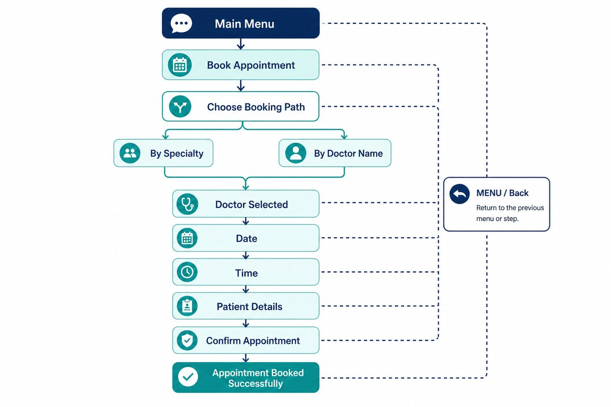

# Conversation Flows

> **Audience:** QA / product / developers  
> **Purpose:** patient-facing WhatsApp journeys, step by step

**Languages:** Arabic and English — the bot replies in the patient's active language.

---

## At a glance

---

## Main menu

On entry (or after MENU / القائمة), the bot shows:

| # | Option |
|:-:|:-------|
| 1 | Book appointment |
| 2 | Reschedule appointment |
| 3 | Cancel appointment |
| 4 | Ask about doctors/specialties |
| 5 | Talk to reception |

Patients can pick from the interactive menu or type an equivalent choice.

---

## Global navigation

| Action | How | Behavior |
|:-------|:----|:---------|
| Main menu | Type MENU or القائمة | Clears the current draft → main menu |
| Step back | Type رجوع, Back, or similar | Moves **one** sensible step backward |

**Notes**

- `MENU` works during active flows.
- Back is state-aware (e.g. time → date, date → doctor, doctor → path choice).
- Confirming a **cancellation** is separate from the global back command.

---

## 1) Book appointment

### A — Choose search path

Bot asks:

- **By specialty**
- **By doctor name**

### Path A1 — By specialty

1. Patient chooses **By specialty**.
2. Bot shows available specialties/departments.
3. Patient picks a specialty.
4. Bot shows doctors for that specialty (cards / selectable options).
5. Patient selects a doctor.
6. Continue from **shared booking steps**.

### Path A2 — By doctor name

1. Patient chooses **By doctor name**.
2. Bot offers doctor selection by name (specialty as supporting text when available).
3. Patient selects a doctor.
4. Continue from **shared booking steps**.

### Shared booking steps

| Step | What happens |
|:-----|:-------------|
| **Date** | Available dates for the selected doctor |
| **Time** | Available slots; **Change day** reopens date selection |
| **Patient details** | Reuse known name if available; else ask for name. DOB only if `REQUIRE_DOB` is enabled |
| **Confirm** | Summary → patient confirms |
| **Success** | Appointment created, slot reserved, reference returned |

### Alternatives / failures

| Situation | Bot response |
|:----------|:-------------|
| No doctors for option | Alternatives: other path, reception, menu |
| No dates/slots for doctor | Alternatives: another doctor, reception, menu |
| No slots on chosen day | Ask for another day |
| Slot hold expired / unavailable | Ask for another time |

### Back behavior (booking)

| From | Back goes to |
|:-----|:-------------|
| Doctor list (by specialty) | Specialty list |
| Doctor list (by name) / specialty list | Booking path choice |
| Date | Doctor selection |
| Time | Date selection |
| Patient details / confirmation | Time selection |

---

## 2) Reschedule appointment

1. Patient chooses **Reschedule**.
2. Bot lists upcoming confirmed appointments (or asks for appointment reference).
3. If none → inform patient / helpful options.
4. Patient picks an appointment.
5. Bot asks what to change.
6. New date (when required).
7. New time slot.
8. Confirm update; slots released/updated.

### Back behavior (reschedule)

| From | Back goes to |
|:-----|:-------------|
| Appointment list | Main menu |
| Change-type | Appointment list |
| Date | Change-type |
| Slot | Date |
| Confirm | Previous step in the chain |

---

## 3) Cancel appointment

1. Patient chooses **Cancel**.
2. Bot lists upcoming confirmed appointments (or asks for reference).
3. If none → inform patient.
4. Patient picks an appointment.
5. Bot asks for cancellation confirmation.
6. On confirm → cancelled, slot released, reminders cancelled, confirmation sent.

### Back behavior (cancel)

| From | Back goes to |
|:-----|:-------------|
| Confirmation | Appointment list |
| Appointment list | Main menu |

---

## 4) Ask about doctors / specialties

1. Patient chooses inquiry from the main menu.
2. Bot offers inquiry options.
3. Patient can browse info and, where offered, continue into booking.

---

## 5) Talk to reception (handover)

1. Patient asks for reception, or bot escalates after unsupported/failed cases.
2. Bot acknowledges transfer.
3. System records handover context (phone, intent, transcript context, doctor/appointment if any).
4. Patient gets a clear handover message.
5. Outside hours / missing config → configured fallback message.

---

## Voice note flow (summary)

| Step | Action |
|:----:|:-------|
| 1 | Patient sends a voice note |
| 2 | Download + STT transcription |
| 3 | Extract intent / entities |
| 4 | Validate availability; advance guided flow when possible |
| 5 | Reply with next step or confirmation |

> Voice is an alternate input into the **same** booking flows — not a separate product path.

---

## Quick test checklist

- [ ] Main menu opens on first contact and after `MENU`
- [ ] Book by specialty completes end-to-end
- [ ] Book by doctor name completes end-to-end
- [ ] Change day works from the time list
- [ ] Reschedule updates an existing appointment
- [ ] Cancel removes an upcoming appointment
- [ ] رجوع / Back returns one step in booking/reschedule/cancel
- [ ] Inquiry and reception/handover respond correctly
- [ ] Voice note can start or continue a booking when speech is clear
